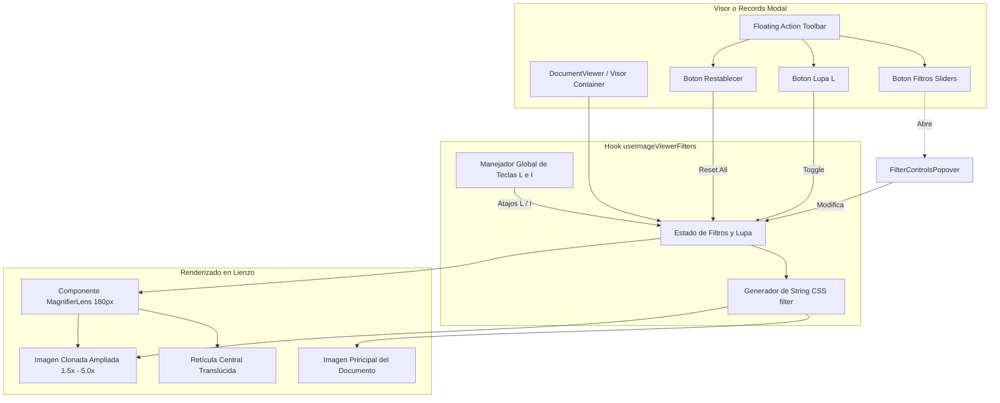

# Plan de Arquitectura Técnica: Mejora de Imagen y Lupa Interactiva (Spec 006)

**Identificador:** `006-image-enhancement-magnifier`  
**Fase SDD:** Paso 4 - Plan de Implementación Técnica  
**Fecha:** 2026-10-12  

---

## 1. Arquitectura General del Módulo

El objetivo técnico es implementar capacidades de mejora visual en tiempo real en el visor de documentos de CodexFlow sin introducir dependencias pesadas de procesamiento en servidor ni bibliotecas invasivas en el frontend. La solución se basa en:
1. **Aceleración por Hardware (GPU)** mediante CSS filters (`filter: brightness(...) contrast(...) invert(...) grayscale(...)`).
2. **Hook de Estado Unificado (`useImageViewerFilters`)** para centralizar la manipulación de filtros, atajos de teclado y persistencia entre folios.
3. **Componente de Lupa Aislado (`MagnifierLens`)** que proyecta una máscara circular (`border-radius: 50%`, `overflow: hidden`, `width: 180px`, `height: 180px`) con compensación de rotación matricial y clonación de estilo visual.
4. **Menú Popover de Controles (`FilterControlsPopover`)** accesible desde la barra flotante con sliders y toggles reactivos.

---

## 2. Diagrama de Flujo y Jerarquía de Componentes



---

## 3. Especificación del Estado y Modelos de Datos

### 3.1 Interfaz de Filtros (`ImageFilterState`)

```typescript
export interface ImageFilterState {
  brightness: number;    // 50 a 200 (default: 100)
  contrast: number;      // 50 a 250 (default: 100)
  sharpness: number;     // 0 a 100 (default: 0)
  invert: boolean;       // default: false (atajo 'I')
  grayscale: boolean;    // default: false
  binarized: boolean;    // default: false (alto contraste B/N)
}

export interface MagnifierState {
  active: boolean;       // default: false (atajo 'L')
  zoomLevel: number;     // 1.5 a 5.0 (default: 2.5)
  cursorX: number;       // Posición X relativa al visor
  cursorY: number;       // Posición Y relativa al visor
  isHovering: boolean;   // Visibilidad dentro del límite de imagen
}
```

### 3.2 Generación de la Cadena CSS `filter`

La función determinística `buildCSSFilterString(filters: ImageFilterState): string` construye la regla CSS compuesta:

```typescript
export function buildCSSFilterString(filters: ImageFilterState): string {
  const parts: string[] = [];

  // Modo Binarizado aplica presets específicos de contraste y desaturación extrema
  if (filters.binarized) {
    parts.push('grayscale(100%)');
    parts.push(`contrast(${Math.max(filters.contrast * 2, 280)}%)`);
    parts.push(`brightness(${filters.brightness * 0.9}%)`);
  } else {
    if (filters.brightness !== 100) {
      parts.push(`brightness(${filters.brightness}%)`);
    }
    if (filters.contrast !== 100) {
      parts.push(`contrast(${filters.contrast}%)`);
    }
    if (filters.grayscale) {
      parts.push('grayscale(100%)');
    }
  }

  if (filters.invert) {
    parts.push('invert(100%)');
  }

  // Sharpness mediante un filtro SVG precompilado o drop-shadow adaptativo si no hay SVG
  if (filters.sharpness > 0) {
    parts.push(`drop-shadow(0 0 ${filters.sharpness * 0.01}px rgba(0,0,0,0.8))`);
  }

  return parts.length > 0 ? parts.join(' ') : 'none';
}
```

---

## 4. Diseño del Componente MagnifierLens

### 4.1 Geometría y Estilos del Lente
- **Contenedor exterior:**
  - Tamaño: Diámetro fijo `180px` (`w-[180px] h-[180px] rounded-full`).
  - Posicionamiento: `absolute`, centrado en `(cursorX - 90)px, (cursorY - 90)px`.
  - Borde óptico: `border-2 border-primary/60 shadow-[0_0_20px_rgba(0,0,0,0.5)]`.
  - Recorte: `overflow-hidden pointer-events-none select-none z-50`.
  - Retícula: Elementos pseudo o líneas SVG superpuestas en el centro (`+` translúcido fino con `mix-blend-mode: difference` o color blanco con opacidad 0.6).

### 4.2 Transformación con Compensación de Rotación
Al rotar la imagen contenedora en ángulos rectos ($\theta \in \{0^\circ, 90^\circ, 180^\circ, 270^\circ\}$):
- La imagen ampliada dentro de la lupa debe reflejar idéntica orientación que la imagen principal pero desplazada proporcionalmente al cursor.
- Si la imagen base tiene dimensiones visuales $(W, H)$ y posición relativa del cursor $(x, y)$ donde $u = x / W$ y $v = y / H$:
  - Posición interior: La imagen interna de la lupa tiene escala `zoomLevel` aplicada mediante `transform: translate3d(-u * W * zoomLevel + 90px, -v * H * zoomLevel + 90px, 0) rotate(rotationDeg)`.
  - Esto garantiza alineación milimétrica en cualquier grado de rotación sin desfases.

---

## 5. Control de Eventos y Manejo del Teclado

### 5.1 Detección de Foco Activo
Para evitar interferir con la transcripción de texto:
```typescript
function isInputActive(): boolean {
  if (typeof document === 'undefined') return false;
  const tag = document.activeElement?.tagName.toLowerCase();
  const isContentEditable = document.activeElement?.getAttribute('contenteditable') === 'true';
  return tag === 'input' || tag === 'textarea' || tag === 'select' || isContentEditable;
}
```

### 5.2 Atajos de Teclado
- **Tecla `L` / `l`:** Si `!isInputActive()`, alterna `magnifier.active = !magnifier.active`.
- **Tecla `I` / `i`:** Si `!isInputActive()`, alterna `filters.invert = !filters.invert`.

### 5.3 Evento de Rueda de Ratón (`wheel`)
- Al estar la lupa activa sobre el área del visor, el listener del evento con `{ passive: false }` invoca `event.preventDefault()` y actualiza el nivel de zoom:
  $$\text{newZoom} = \text{clamp}(\text{zoomLevel} + \Delta, 1.5, 5.0)$$
  donde $\Delta = -0.25$ si `deltaY > 0` y $+0.25$ si `deltaY < 0`.

---

## 6. Persistencia y Ciclo de Vida del Visor

- **Al cambiar de folio (Prop `folioId` o `currentFolio` cambia):**
  - Los filtros (`brightness`, `contrast`, `sharpness`, `invert`, `grayscale`, `binarized`) **SE CONSERVAN** en memoria de la sesión para mantener la calibración de lectura seleccionada por el usuario.
  - La lupa se desactiva explícitamente (`active: false`) para evitar superposición anómala durante la transición de imagen.
- **Al pulsar botón "Restablecer" (`resetAll`):**
  - Zoom general $\rightarrow$ 1.0x.
  - Posición pan $\rightarrow$ `(0, 0)`.
  - Rotación $\rightarrow$ 0°.
  - Lupa $\rightarrow$ inactiva.
  - Filtros $\rightarrow$ valores iniciales (`brightness: 100`, `contrast: 100`, `sharpness: 0`, `invert: false`, `grayscale: false`, `binarized: false`).

---

## 7. Plan de Integración en el Frontend

1. **Nuevo Hook Reutilizable:**  
   `frontend/src/hooks/useImageViewerFilters.ts` (manejo de estado, atajos de teclado, cálculo CSS y reset).
2. **Nuevos Componentes Modulares:**  
   - `frontend/src/components/viewer/MagnifierLens.tsx` (lente 180px, retícula, rotación).
   - `frontend/src/components/viewer/FilterControlsPopover.tsx` (popover flotante, sliders y toggles).
3. **Integración en Componentes Existentes:**  
   - `frontend/src/components/DocumentViewer.tsx` o visor nativo en `frontend/src/app/[subdomain]/visor/page.tsx`: Inclusión del botón de lupa en la barra flotante, popover de filtros y renderizado del lente sobre la imagen.
   - Modal de detalle de partidas en `frontend/src/app/[subdomain]/records/page.tsx`: Inclusión de los controles y visualización de lupa en la previsualización de documento adjunto.

---

## 8. Consideraciones de Rendimiento y GPU

- Toda transformación de desplazamiento del lente utiliza `transform: translate3d(...)` para delegar la composición directamente al compositor de la GPU sin disparar reflows de la página.
- Se utiliza `will-change: transform` en el elemento contenedor de la lupa para que el navegador cree una capa de composición dedicada.
- El evento `onMouseMove` se estrangula o ejecuta dentro de `requestAnimationFrame` para mantener una tasa de refresco fluida de 60 FPS incluso con imágenes de alta definición.
