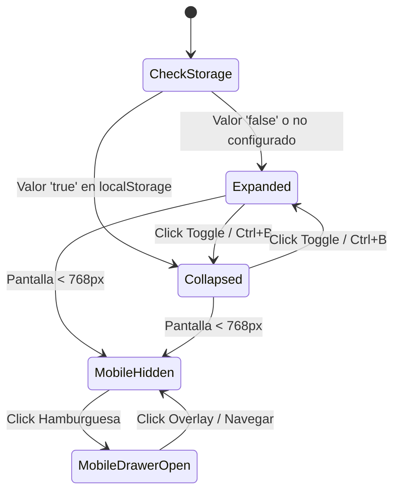

# Plan de Arquitectura Técnica: Barra Lateral Colapsable y Métricas de Digitador (Spec 007)

**Identificador:** `007-collapsible-sidebar`  
**Fase SDD:** Paso 4 - Plan de Implementación Técnica  
**Fecha:** 2026-10-12  

---

## 1. Arquitectura General del Sistema

El módulo se compone de dos subsistemas estrechamente integrados:
1. **Sistema de Navegación Reactivo y Persistente (Frontend):**
   - **`SidebarContext` / `SidebarProvider`:** Maneja el estado global del sidebar (`isCollapsed`, `isMobileOpen`, `toggleCollapsed`, `toggleMobile`, `setCollapsed`).
   - **Hydration Safe Pattern:** Inicialización controlada con `useEffect` para leer `localStorage` en el cliente sin provocar *Hydration Mismatch* en Next.js App Router (SSR).
   - **Atajo Global de Teclado:** Captura `Ctrl + B` con guardia anti-escritura en inputs.
   - **Componentes Modulares:** `Sidebar`, `SidebarHeader`, `SidebarItem` (con Tooltip flotante posicionado con CSS absoluto/fixed), y adaptación de `LogoutButton`.
   - **Layout Responsivo:** Sincronización continua de transiciones de ancho (`w-64` a `w-16`) y margen de contenido (`ml-64` a `ml-16`). Soporte de Drawer móvil con overlay.
2. **Módulo de Productividad y Métricas de Digitador (Frontend + Backend):**
   - **Extensión de Rutas del Tenant:** Actualización de reglas en `frontend/src/app/[subdomain]/layout.tsx` para admitir al digitador en `/[subdomain]/visor` y la nueva ruta `/[subdomain]/metrics`.
   - **Vista de Métricas:** `frontend/src/app/[subdomain]/metrics/page.tsx` con tarjetas métricas (KPIs), gráficas de avance y tabla de folios procesados.
   - **Backend API:** Endpoint `/api/v1/digitizer/metrics` en `backend/main.py` protegido por autenticación JWT Supabase y filtro multi-tenant por `user_id` y `tenant_id`.

---

## 2. Diagrama de Arquitectura y Flujo de Componentes

```mermaid
flowchart TD
    subgraph Frontend SubdomainLayout
        SP[SidebarProvider]
        Nav[Sidebar Desktop w-64 / w-16]
        Mob[Drawer Movil < 768px]
        MC[Main Content ml-64 / ml-16]
    end

    subgraph Componentes de Navegacion
        Header[SidebarHeader: Logo CF + Toggle PanelLeft]
        Items[SidebarItems con Tooltips Flotantes]
        Logout[LogoutButton: Icono Centrado + Tooltip]
        Shortcut[useKeyboardShortcut Ctrl+B]
    end

    subgraph Vista de Metricas /[subdomain]/metrics
        KpiCards[Tarjetas KPI: Hoy / 7 Dias / Historico]
        RecentTable[Historial de Folios Procesados]
        FetchHook[SWR / React Fetch a Backend]
    end

    subgraph Backend FastAPI
        Endpoint[GET /api/v1/digitizer/metrics]
        AuthCheck[Validar JWT + get_auth_context]
        DB[(Supabase DB: folios & folios_audit)]
    end

    SP --> Nav
    SP --> Mob
    SP --> MC
    Nav --> Header
    Nav --> Items
    Nav --> Logout
    SP --> Shortcut
    MC --> FetchHook
    FetchHook --> Endpoint
    Endpoint --> AuthCheck
    AuthCheck --> DB
```

---

## 3. Especificación Técnica de Componentes Frontend

### 3.1 `SidebarContext` (`frontend/src/context/SidebarContext.tsx`)
Maneja el estado y sincronización de almacenamiento local:
- **Estado:**
  - `isCollapsed: boolean` (por defecto `false`).
  - `isMobileOpen: boolean` (por defecto `false`).
  - `isMounted: boolean` (evita renders desincronizados antes del cliente).
- **Almacenamiento Local:** Clave `'codexflow_sidebar_collapsed'`.
- **Efecto de Montaje:**
  ```typescript
  useEffect(() => {
    try {
      const saved = localStorage.getItem('codexflow_sidebar_collapsed');
      if (saved !== null) {
        setIsCollapsed(saved === 'true');
      }
    } catch (e) {
      // Ignorar bloqueos de storage en navegadores restrictivos
    } finally {
      setIsMounted(true);
    }
  }, []);
  ```
- **Atajo `Ctrl + B`:**
  ```typescript
  useEffect(() => {
    const handleKeyDown = (e: KeyboardEvent) => {
      if ((e.ctrlKey || e.metaKey) && e.key.toLowerCase() === 'b') {
        const target = e.target as HTMLElement | null;
        const isEditable = target && (
          target.tagName === 'INPUT' ||
          target.tagName === 'TEXTAREA' ||
          target.tagName === 'SELECT' ||
          target.isContentEditable
        );
        if (!isEditable) {
          e.preventDefault();
          toggleCollapsed();
        }
      }
    };
    window.addEventListener('keydown', handleKeyDown);
    return () => window.removeEventListener('keydown', handleKeyDown);
  }, []);
  ```

### 3.2 Componente `Sidebar` (`frontend/src/components/Sidebar.tsx`)
Estructura y estilos:
- **Ancho dinámico:** `${isCollapsed ? 'w-16' : 'w-64'} transition-all duration-300 ease-in-out`.
- **Cabecera:**
  - Logo: `{isCollapsed ? 'CF' : 'CodexFlow'}` con tipografía destacada.
  - Botón Conmutador: `button` con ícono `PanelLeftClose` (expandido) o `PanelLeftOpen` (plegado) con `aria-label` descriptivo.
- **Lista de Enlaces (`SidebarItem`):**
  - Renderizado condicional según rol:
    - **Digitador (`digitizer`):**
      - `/{subdomain}/visor` ("Visor de Indexación", ícono `FileSearch`).
      - `/{subdomain}/metrics` ("Mis Métricas", ícono `BarChart3`).
    - **Administrador (`admin`) / Archivista (`archivist`):**
      - `/{subdomain}/dashboard` ("Dashboard", ícono `LayoutDashboard`).
      - `/{subdomain}/ingest` ("Ingesta/Dudosos", ícono `UploadCloud`).
      - `/{subdomain}/visor` ("Visor de Indexación", ícono `FileSearch`).
      - `/{subdomain}/records` ("Registros", ícono `BookOpen`).
      - `/{subdomain}/settings/users` ("Equipo", ícono `Users`).
- **Tooltip Flotante en Modo Plegado:**
  - Implementado mediante un contenedor relativo con un badge posicionado absolutamente:
    `absolute left-full ml-3 px-2.5 py-1.5 bg-gray-950 text-white text-xs rounded-md shadow-xl whitespace-nowrap opacity-0 group-hover:opacity-100 transition-opacity pointer-events-none z-50`.
- **Botón Logout Plegado:**
  - En modo expandido: Texto "Cerrar Sesión" + icono.
  - En modo colapsado: Solo icono `LogOut` centrado con tooltip rojo sutil flotante.

### 3.3 Layout de Subdominio (`frontend/src/app/[subdomain]/layout.tsx`)
- Envolver contenido en `<SidebarProvider>`.
- Ajustar contenedor principal con margen reactivo:
  `className={`flex-1 transition-all duration-300 ease-in-out ${isCollapsed ? 'md:ml-16' : 'md:ml-64'}`}`.
- Actualizar validación de rutas para Digitador:
  - Permitir `pathname.includes('/visor')` O `pathname.includes('/metrics')`.
  - Si el digitador navega a cualquier otra ruta, redirigir a `/[subdomain]/visor`.
  - Eliminar el condicional `{!isDigitizer && role && <Sidebar ... />}` para permitir que el digitador vea la barra.

---

## 4. Especificación Técnica del Backend (FastAPI)

### 4.1 Endpoint `GET /api/v1/digitizer/metrics`
- **Ubicación:** `backend/main.py`
- **Seguridad:** Inyección de dependencias `auth: Dict[str, Any] = Depends(get_auth_context)`.
- **Reglas de Acceso:**
  - Valida que el usuario pertenezca al tenant del encabezado (`auth["tenant_id"]`).
  - Permite acceso tanto a `digitizer` como a `admin` (si el admin consulta su propia productividad).
- **Lógica de Consulta:**
  1. Extraer fecha UTC actual `now = datetime.now(timezone.utc)`.
  2. Determinar inicio de hoy `today_start = now.replace(hour=0, minute=0, second=0, microsecond=0)`.
  3. Determinar inicio de 7 días atrás `seven_days_ago = now - timedelta(days=7)`.
  4. Consultar en la tabla de folios (`folios`) los registros donde:
     - `tenant_id == auth["tenant_id"]`
     - (`transcribed_by == auth["user_id"]` OR `assigned_to == auth["user_id"]` según esquema de auditoría).
  5. Calcular:
     - `folios_today`: Registros completados con `completed_at >= today_start`.
     - `folios_last_7_days`: Registros completados con `completed_at >= seven_days_ago`.
     - `folios_total_verified`: Total histórico con estado `'verified'` o `'completed'`.
- **Modelo de Respuesta Pydantic:**
  ```python
  class DigitizerMetricsResponse(BaseModel):
      user_id: str
      tenant_id: str
      full_name: Optional[str]
      folios_today: int
      folios_last_7_days: int
      folios_total_verified: int
      last_activity_at: Optional[datetime]
  ```

---

## 5. Diseño de la Vista de Métricas (`/[subdomain]/metrics`)

### 5.1 Estructura Visual
- **Cabecera:** Título "Mis Métricas de Indexación" con subtítulo descriptivo e indicador de última actualización.
- **Grilla de KPIs (3 Columnas):**
  1. **Folios Hoy:** Icono `CalendarCheck`, número grande, estado de actividad diario.
  2. **Últimos 7 Días:** Icono `TrendingUp`, comparativa semanal.
  3. **Total Histórico Verificado:** Icono `Award` o `CheckCircle2`, acumulado general auditado.
- **Panel de Historial de Producción:**
  - Tabla compacta con columnas: Folio / Libro, Fecha de Transcripción, Estado de Validación y Acceso Rápido al Visor.
- **Manejo de Estados:**
  - `isLoading`: Skeleton loaders en tarjetas y tabla.
  - `error`: Banner informativo con botón de reintento.
  - `empty`: Mensaje motivacional invitando a iniciar la indexación en el Visor.

---

## 6. Diagrama de Estados del Sidebar



---

## 7. Plan de Validación y Pruebas

1. **Pruebas de Componentes (Unitarias / Integración):**
   - Renderizado del Sidebar en anchos 256px y 64px.
   - Disparo correcto del atajo `Ctrl + B` con simulación de target regular y target `INPUT` (verificando que en `INPUT` no colapse).
   - Verificación de tooltips flotantes en `hover` sobre modo plegado.
2. **Pruebas de Rutas y Permisos:**
   - Comprobar que usuario `digitizer` ve únicamente `Visor`, `Mis Métricas` y `Logout`.
   - Redirección automática de un digitador que intente navegar a `/dashboard`.
3. **Pruebas de API Backend:**
   - Test del endpoint `/api/v1/digitizer/metrics` con mock de Supabase verificando conteos exactos por fechas y filtrado estricto por `tenant_id` y `user_id`.
