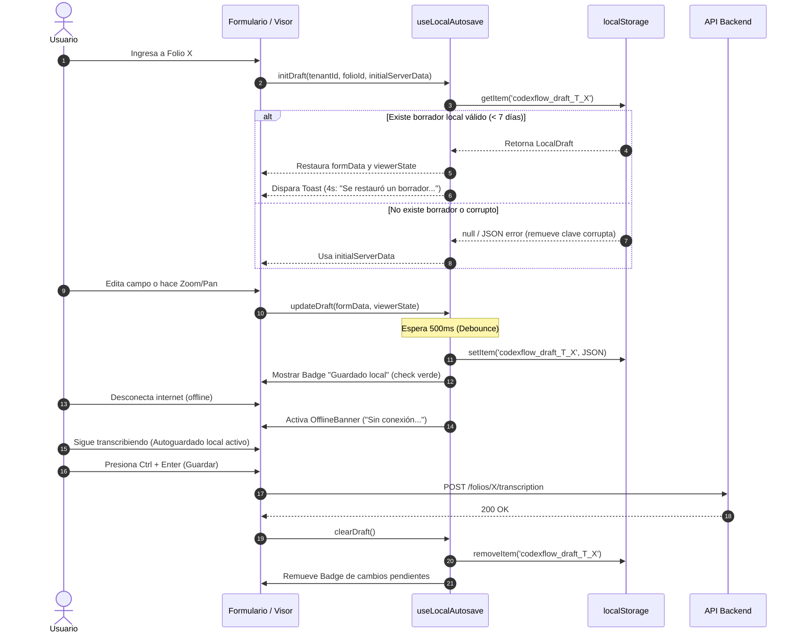

# Plan de Implementación Técnica
## Módulo: Autoguardado Local y Recuperación Offline (010-local-autosave-offline-recovery)

### 1. Arquitectura y Visión General
El objetivo de este módulo es proporcionar persistencia en el cliente sin backend dependiente durante la sesión activa de transcripción, desacoplando la captura de datos de la disponibilidad de la red y previniendo pérdidas por desconexión o accidentes de navegación.

```mermaid
flowchart TD
    subgraph UI ["Capa de Interfaz de Usuario"]
        Form[Transcription Form]
        Visor[Image Viewer]
        Badge[Badge Guardado Local]
        Banner[Banner Modo Offline]
        Toast[Toast Restauración 4s]
    end

    subgraph Hook ["Hook Centralizado: useLocalAutosave"]
        Debounce[Debounce 500ms]
        StorageManager[LocalStorage Manager]
        NetworkListener[Network Listener (online/offline)]
        UnloadListener[beforeunload Guard]
    end

    subgraph Storage ["Almacenamiento Local"]
        LS[("localStorage\nkey: codexflow_draft_[tenant]_[folio]")]
    end

    Form -->|onChange formData| Debounce
    Visor -->|onViewportChange zoom/pan/rot| Debounce
    Debounce --> StorageManager
    StorageManager -->|JSON stringify| LS
    StorageManager -->|Estado guardado| Badge
    NetworkListener -->|navigator.onLine === false| Banner
    LS -->|Mount / Restore| StorageManager
    StorageManager -->|Restore Data| Form
    StorageManager -->|Restore Viewport| Visor
    StorageManager -->|Notificar| Toast
    UnloadListener -->|Verificar cambios pendientes| UI
```

---

### 2. Estructuras de Datos y Contratos TypeScript

#### 2.1 Modelo de Datos del Borrador (`LocalDraft`)
```typescript
export interface ViewerState {
  zoom: number;
  panX: number;
  panY: number;
  rotation: number;
}

export interface LocalDraft<T = Record<string, any>> {
  version: number;                // Versión de esquema para migraciones futuras (e.g., 1)
  tenantId: string;               // ID de la diócesis/parroquia
  folioId: string;                // ID del folio
  formData: T;                    // Estado completo del formulario de transcripción
  modifiedFields: string[];       // Nombres de campos con alteraciones directas
  viewerState: ViewerState;       // Coordenadas de visualización de la imagen
  updatedAt: number;              // Timestamp epoch (ms)
}
```

#### 2.2 Clave de Almacenamiento y TTL
- **Patrón de Clave:** `codexflow_draft_${tenantId}_${folioId}`
- **Prefijo Global:** `codexflow_draft_`
- **TTL Máximo:** `7 * 24 * 60 * 60 * 1000` ms (7 días naturales).

---

### 3. Componentes y Módulos a Crear / Modificar

#### 3.1 Hook `useLocalAutosave.ts`
Ubicación: `frontend/src/hooks/useLocalAutosave.ts` (o ruta análoga del proyecto).
Responsabilidades:
1. **Debounced Writer:** Utilizar un temporizador de 500 ms tras cada cambio en `formData` o `viewerState`.
2. **Parser Seguro:** Envolver lecturas en `try / catch` ante `SyntaxError` (JSON corrupto) eliminando la clave silenciosamente con `localStorage.removeItem(key)`.
3. **Manejador de Cuota:** Capturar excepciones `QuotaExceededError` ejecutando `purgeOrphanDrafts()`.
4. **Purga Automática de 7 días:** Escanear claves con prefijo `codexflow_draft_` al montar la aplicación y remover aquellas con `Date.now() - draft.updatedAt > TTL`.
5. **Detección de Conexión:** Subscribirse a `window.addEventListener('online')` y `window.addEventListener('offline')` manteniendo un estado reactivo `isOnline`.
6. **Protección `beforeunload`:** Registrar `window.addEventListener('beforeunload', handler)` cuando haya cambios no sincronizados en backend.

#### 3.2 Indicadores Visuales
1. **`AutosaveBadge.tsx`:**
   - Ubicado en la barra superior o cabecera del editor.
   - Estado "Guardado local": Ícono `Check` verde con microanimación de pulso/fade.
   - Estado "Guardando...": Indicador sutil de sincronización local.
2. **`OfflineBanner.tsx`:**
   - Barra fija superior con estilo warning/amber/red accesible:
   - *"Sin conexión: Tu trabajo se sigue guardando localmente; podrás sincronizar cuando vuelva internet"*.
3. **Modal de Descarte (`DiscardDraftModal.tsx`) / Atajo `Alt + D`:**
   - Escuchar evento de teclado `Alt + D`.
   - Mostrar modal de confirmación: "¿Deseas descartar el borrador local y recargar los datos originales del servidor?".
   - Al confirmar: `clearDraft()` y recarga de datos limpios.
4. **Limpieza en Operaciones Backend:**
   - En el callback de éxito de `saveTranscription` (`Ctrl + Enter`) -> invocar `clearDraft()`.
   - En el callback de éxito de `markAsDoubtful` (`Ctrl + Space`) -> invocar `clearDraft()`.

---

### 4. Diagrama de Secuencia: Ciclo de Vida del Borrador



---

### 5. Plan de Pruebas y Validación Técnica
1. **Prueba de Debounce:** Disparar 50 pulsaciones de teclado consecutivas; asegurar que solo se realiza 1 llamada de persistencia a `localStorage` 500 ms tras la última pulsación.
2. **Prueba de Aislamiento Tenant/Folio:** Verificar que al cambiar de folio o tenant la clave corresponde estrictamente a `'codexflow_draft_[tenant_id]_[folio_id]'`.
3. **Prueba de Resiliencia Corrupción JSON:** Inyectar manualmente una cadena corrupta `{invalid_json...` en la clave de almacenamiento; verificar que el sistema no explote, borre la clave y cargue los datos del servidor sin error.
4. **Prueba de TTL:** Inyectar una fecha con 8 días de antigüedad; al iniciar debe ser purgada automáticamente.
5. **Prueba de Atajo y Descarte:** Presionar `Alt + D`, confirmar diálogo y verificar reseteo al estado inicial.
