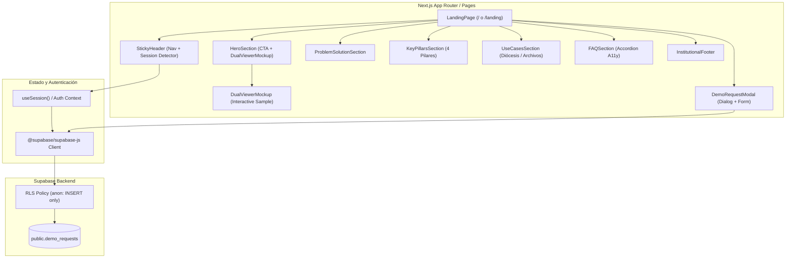

# Plan de Arquitectura Técnica: Landing Page Oficial de CodexFlow

**Identificador de Plan:** `PLAN-011`  
**Referencia de Especificación:** `specs/011-official-landing-page/spec.md`  
**Versión:** 1.0.0  
**Fecha:** 2026-10-12  
**Estado:** Planificación Aprobada  

---

## 1. Visión General de la Arquitectura

La Landing Page oficial de CodexFlow está concebida como una experiencia web responsiva de alto rendimiento integrada en el frontend de Next.js / React de la aplicación. Aprovechará Tailwind CSS con la paleta temática institucional (Slate-950, Slate-900, Slate-800, Azul `#2563EB`, Esmeralda `#10B981`) y componentes modulares desacoplados.

La persistencia de las solicitudes de demostración se implementa con Supabase PostgreSQL mediante una tabla `demo_requests` protegida con Row-Level Security (RLS) que otorga permisos de solo inserción al rol público (`anon`), previniendo cualquier filtración de datos entre prospectos.

---

## 2. Diagrama de Arquitectura de Componentes



---

## 3. Desglose Modular de Componentes

### 3.1. `StickyHeader`
- **Ruta sugerida:** `components/landing/StickyHeader.tsx`
- **Responsabilidad:** Barra superior `fixed top-0` con backdrop blur (`backdrop-blur-md bg-slate-950/80 border-b border-slate-800`).
- **Comportamiento:**
  - Consulta reactiva del estado de sesión (`useSession` o `supabase.auth.getUser()`).
  - Si el usuario está autenticado: botón "Ir a mi Panel" con enlace a `/batches`.
  - Si es anónimo: botón "Iniciar Sesión" (`/login`) y botón "Solicitar Demo" (dispara evento o modal state).
  - Enlaces de salto suave: `#caracteristicas`, `#seguridad`, `#casos-de-uso`, `#faq`.
  - Menú desplegable para móviles (< 768px).

### 3.2. `HeroSection` y `DualViewerMockup`
- **Rutas sugeridas:** 
  - `components/landing/HeroSection.tsx`
  - `components/landing/DualViewerMockup.tsx`
- **Responsabilidad:**
  - Titular H1 institucional y subtítulo persuasivo.
  - Botones de acción directos (CTA).
  - Componente `DualViewerMockup`: Interfaz simulada del visor dual de CodexFlow que demuestra visualmente:
    - Lado Izquierdo: Facsímil o manuscrito histórico de alta definición con bounding box destacado en color esmeralda (`#10B981`) y simulador de lupa óptica de 180px con aumento 2.5x.
    - Lado Derecho: Formulario de indexación con campos prellenados al 80% (Nombres: "Pedro Joseph", Apellidos: "Gómez de la Parra", Parroquia: "Santa Inés de Cumaná", Fecha: "14 de Mayo de 1782", Padrinos: "Don Juan Manuel de Sucre").
    - Pestaña interactiva para cambiar entre 2 ejemplos de documentos (ej. Partida de Bautismo siglo XVIII vs. Acta Matrimonial siglo XIX).

### 3.3. `ProblemSolutionSection`
- **Ruta sugerida:** `components/landing/ProblemSolutionSection.tsx`
- **Responsabilidad:** Contraste en dos columnas:
  - *Columna Izquierda (Tradicional / Crítico):* Tarjetas en tonos ámbar/rojo tenue ilustrando deterioro de tomos, transcripciones manuales en Excel que toman meses, pérdida de contexto caligráfico y búsqueda no indexada.
  - *Columna Derecha (CodexFlow / Eficiente):* Tarjetas en esmeralda/azul ilustrando preservación perenne, aceleración 5x por IA con revisión humana, visor ergonómico con cero fricción y exportación de libros de índice limpios.

### 3.4. `KeyPillarsSection`
- **Ruta sugerida:** `components/landing/KeyPillarsSection.tsx`
- **Responsabilidad:** Grid responsivo destacando los 4 pilares centrales:
  1. **Ergonomía Extrema:** Visor dual, teclado 100% libre de ratón, lupa circular de 180px, filtros binarizados y alto contraste.
  2. **IA Asistida & Active Learning:** Reconocimiento de bounding boxes, prellenado del 80% de campos y auto-mejora del modelo con cada partida validada por el operador.
  3. **Seguridad y Multi-Tenancy Diocesano:** Aislamiento estricto RLS por parroquia/diócesis, almacenamiento en Cloudflare R2 sin costo de salida y auditoría.
  4. **Exportación Formal e Integración:** Exportación nativa a Excel estilizado (`.xlsx`) y CSV estructurado (`;`) para genealogistas y archivos nacionales.

### 3.5. `UseCasesSection`
- **Ruta sugerida:** `components/landing/UseCasesSection.tsx`
- **Responsabilidad:** Presentación de 3 tarjetas institucionales con detalles contextuales:
  - Curias Diocesanas y Archivos Parroquiales (Bautismos, Confirmaciones, Matrimonios, Defunciones).
  - Archivos Generales y Notariales (Protocolos notariales, testamentos, mercedes de tierras).
  - Registros Civiles y Bibliotecas Patrimoniales (Censos, padrones históricos, libros de extranjería).

### 3.6. `FAQSection`
- **Ruta sugerida:** `components/landing/FAQSection.tsx`
- **Responsabilidad:** Acordeón interactivo accesible con las 5 preguntas del Triple Filtro QA. Animación suave de apertura/cierre y etiquetas semánticas (`details`/`summary` o Radix/Headless UI Accordion).

### 3.7. `DemoRequestModal`
- **Ruta sugerida:** `components/landing/DemoRequestModal.tsx`
- **Responsabilidad:** Ventana modal flotante con gestión de foco accesible.
  - Campos: Nombre completo, Institución/Organización, Correo institucional, Teléfono y Mensaje/Volumen documental.
  - Validación con Zod / React Hook Form o estado nativo de React.
  - Manejo de estados: `idle`, `submitting`, `success`, `error`.
  - Envío a Supabase (`supabase.from('demo_requests').insert(...)`).

### 3.8. `InstitutionalFooter`
- **Ruta sugerida:** `components/landing/InstitutionalFooter.tsx`
- **Responsabilidad:** Pie de página sobrio con enlaces legales, aviso de privacidad patrimonial, badges de seguridad y copyright dinámico (`new Date().getFullYear()`).

---

## 4. Esquema de Base de Datos y Modelo de Seguridad (Supabase RLS)

### 4.1. Definición de la Tabla `demo_requests`

```sql
-- Creación de la tabla demo_requests
CREATE TABLE IF NOT EXISTS public.demo_requests (
    id UUID PRIMARY KEY DEFAULT gen_random_uuid(),
    nombre_completo TEXT NOT NULL,
    organizacion TEXT NOT NULL,
    email TEXT NOT NULL,
    telefono TEXT,
    mensaje TEXT NOT NULL,
    status TEXT NOT NULL DEFAULT 'pending',
    created_at TIMESTAMPTZ NOT NULL DEFAULT timezone('utc'::text, now())
);

-- Habilitar Row Level Security (RLS)
ALTER TABLE public.demo_requests ENABLE ROW LEVEL SECURITY;

-- Política 1: Permitir únicamente INSERT a usuarios anónimos y autenticados
CREATE POLICY "Permitir inserción pública de demo_requests"
ON public.demo_requests
FOR INSERT
TO anon, authenticated
WITH CHECK (true);

-- Política 2: Solo administradores autorizados pueden consultar las solicitudes
CREATE POLICY "Solo administradores pueden leer demo_requests"
ON public.demo_requests
FOR SELECT
TO authenticated
USING (auth.jwt() ->> 'role' = 'service_role' OR auth.jwt() ->> 'is_superadmin' = 'true');
```

---

## 5. Metadatos SEO, OpenGraph y Twitter Cards

Para garantizar una presentación profesional al compartir enlaces en redes institucionales y mensajería (WhatsApp, LinkedIn, Twitter):

```html
<title>CodexFlow — Plataforma Inteligente de Digitalización e Indexación de Archivos Históricos</title>
<meta name="description" content="Preservación patrimonial y transcripción asistida por Inteligencia Artificial para diócesis, archivos notariales y registros civiles con ergonomía extrema y seguridad RLS." />

<!-- OpenGraph / Facebook / WhatsApp -->
<meta property="og:type" content="website" />
<meta property="og:title" content="CodexFlow — Digitalización e Indexación de Archivos Históricos" />
<meta property="og:description" content="Acelera la catalogación y transcripción de fondos históricos con visor dual ergonómico e IA asistida con Active Learning." />
<meta property="og:image" content="/images/og-preview.png" />
<meta property="og:url" content="https://codexflow.app/" />

<!-- Twitter Cards -->
<meta name="twitter:card" content="summary_large_image" />
<meta name="twitter:title" content="CodexFlow — Digitalización de Archivos Históricos" />
<meta name="twitter:description" content="Plataforma SaaS para la indexación y preservación de documentos históricos y parroquiales." />
<meta name="twitter:image" content="/images/og-preview.png" />
```

---

## 6. Estrategia de Pruebas y Validación

1. **Pruebas de Accesibilidad:** Contrastes de color certificados en WCAG 2.1 AA, etiquetas `aria-expanded` en el FAQ y foco atrapado en el modal de demo.
2. **Pruebas de Responsividad:** Inspección en resoluciones de 375px (iPhone), 768px (iPad portrait), 1024px (iPad landscape) y 1920px (Desktop Full HD).
3. **Pruebas de Seguridad RLS:** Intentar realizar una consulta `SELECT` anónima desde el cliente de Supabase para confirmar que retorna vacío o denegado por política.
4. **Pruebas de Persistencia:** Enviar una solicitud desde el formulario y verificar la inserción con id UUID y timestamp en `demo_requests`.
