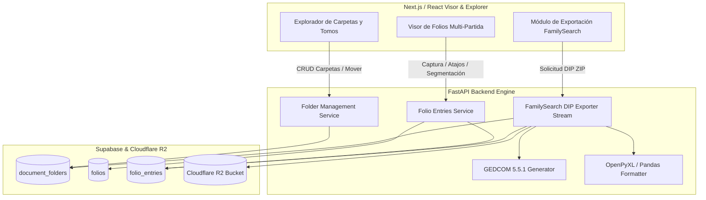
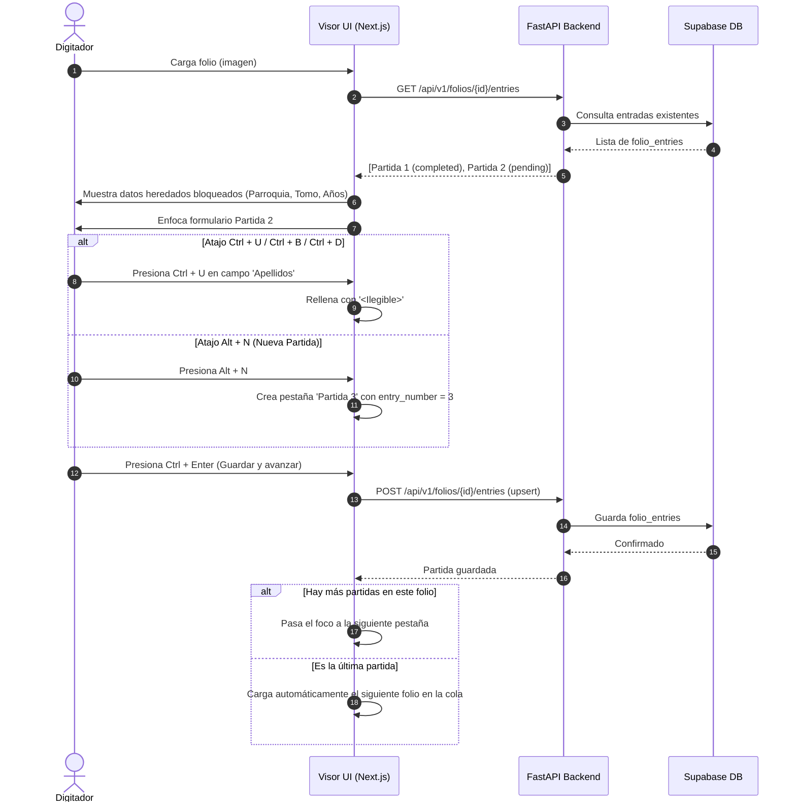
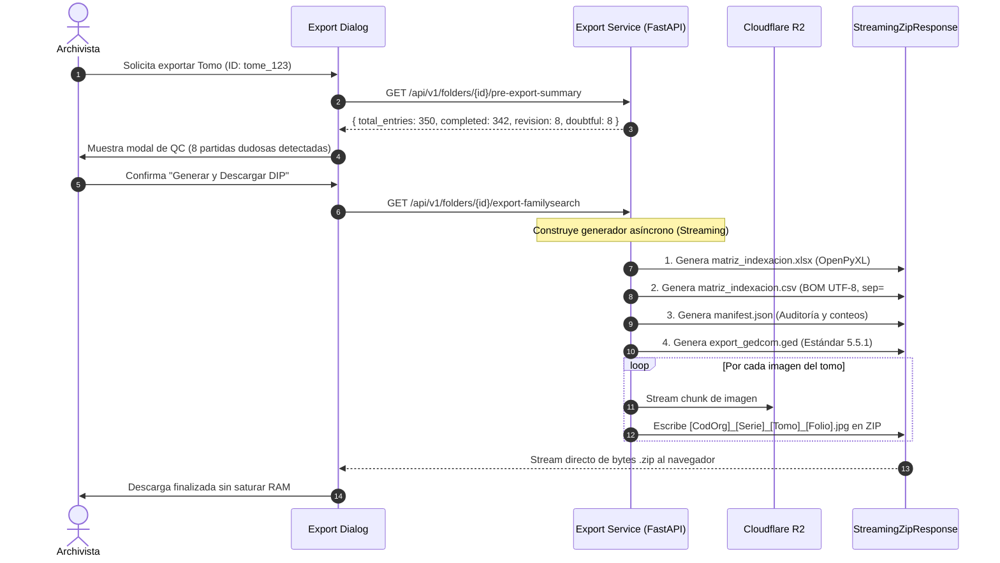

# Arquitectura Técnica y Plan de Implementación: Gestión de Carpetas/Tomos e Interoperabilidad FamilySearch

**Identificador de Especificación:** `SPEC-012`  
**Fase SDD:** Paso 4 - Plan de Arquitectura Técnica  
**Estado:** Listo para Implementación  
**Autor:** Agente Planificador SDD  

---

## 1. Visión General de la Arquitectura

La especificación `SPEC-012` amplía la plataforma CodexFlow para dar soporte de nivel internacional a la digitalización, indización y preservación archivística de fondos documentales parroquiales y notariales, alineándose con las directrices operativas de **FamilySearch (DCam & Indexing)** y el modelo **OAIS (Open Archival Information System)** mediante la generación de paquetes **DIP (Dissemination Information Package)**.

El sistema se compone de tres pilares arquitectónicos:
1. **Árbol Jerárquico de Carpetas (`document_folders`):** Modelo de datos auto-referenciado (`parent_id`) con control de acceso basado en roles (RBAC) y aislamiento multi-inquilino estricto (RLS), organizando Diócesis $\rightarrow$ Parroquia $\rightarrow$ Serie $\rightarrow$ Tomo.
2. **Modelo Multi-Partida por Folio (`folio_entries`):** Desacoplamiento de la imagen del folio físico (`folios`) respecto a las unidades documentales individuales (bautismos, matrimonios, defunciones) que contiene, permitiendo captura ergonómica con atajos FamilySearch (`Alt + N`, `Ctrl + Enter`, `Ctrl + U`, `Ctrl + B`, `Ctrl + D`) y segmentación espacial de IA.
3. **Motor de Exportación e Interoperabilidad FamilySearch (DIP Generator):** Servicio de exportación en streaming que empaqueta en `.ZIP` matrices tabulares (`.xlsx`, `.csv`), metadatos técnicos y de procedencia (`manifest.json`), archivo genealógico estándar (`export_gedcom.ged` versión 5.5.1) e imágenes con nomenclatura canónica normalizada.



---

## 2. Modelo de Datos Relacional y Esquema SQL (Supabase)

### 2.1. Tabla: `document_folders`
Representa el árbol jerárquico documental. Soporta anidación infinita mediante `parent_id` con restricción de integridad referencial `ON DELETE RESTRICT` para evitar pérdida accidental de ramas completas.

```sql
CREATE TYPE folder_type_enum AS ENUM ('root', 'parish', 'series', 'tome');

CREATE TABLE document_folders (
    id UUID PRIMARY KEY DEFAULT gen_random_uuid(),
    tenant_id UUID NOT NULL REFERENCES organizations(id) ON DELETE CASCADE,
    parent_id UUID REFERENCES document_folders(id) ON DELETE RESTRICT,
    name VARCHAR(255) NOT NULL,
    folder_type folder_type_enum NOT NULL,
    code VARCHAR(50), -- Código canónico ej. 'DIOC_CAR', 'PARR_SAN_JOSE', 'SER_BAU', 'T01'
    metadata JSONB DEFAULT '{}'::jsonb, 
    -- metadata contiene:
    --   start_year: INTEGER
    --   end_year: INTEGER
    --   tome_number: VARCHAR(20)
    --   shelf_location: VARCHAR(100) (estante / caja)
    --   template_id: UUID (plantilla asignada al tomo)
    --   is_virtual_unclassified: BOOLEAN
    created_by UUID REFERENCES auth.users(id),
    created_at TIMESTAMPTZ DEFAULT NOW(),
    updated_at TIMESTAMPTZ DEFAULT NOW()
);

-- Índices de desempeño
CREATE INDEX idx_document_folders_tenant ON document_folders(tenant_id);
CREATE INDEX idx_document_folders_parent ON document_folders(parent_id);
CREATE INDEX idx_document_folders_type ON document_folders(folder_type);
```

### 2.2. Actualización de Tabla: `folios`
Se vincula el folio a la carpeta documental correspondiente:
```sql
ALTER TABLE folios 
ADD COLUMN folder_id UUID REFERENCES document_folders(id) ON DELETE SET NULL,
ADD COLUMN sequence_order INT DEFAULT 0,
ADD COLUMN original_filename VARCHAR(255),
ADD COLUMN canonical_filename VARCHAR(255);

CREATE INDEX idx_folios_folder_id ON folios(folder_id);
```

### 2.3. Tabla: `folio_entries`
Almacena cada partida individual capturada dentro de un folio físico (multi-partida FamilySearch Indexing).
```sql
CREATE TYPE entry_status_enum AS ENUM ('pending', 'completed', 'revision');

CREATE TABLE folio_entries (
    id UUID PRIMARY KEY DEFAULT gen_random_uuid(),
    tenant_id UUID NOT NULL REFERENCES organizations(id) ON DELETE CASCADE,
    folio_id UUID NOT NULL REFERENCES folios(id) ON DELETE CASCADE,
    entry_number INT NOT NULL, -- 1, 2, 3... dentro del mismo folio
    status entry_status_enum NOT NULL DEFAULT 'pending',
    metadata JSONB NOT NULL DEFAULT '{}'::jsonb, 
    -- metadata almacena los campos de la persona y del sacramento:
    --   first_name, last_name, event_date (YYYY-MM-DD), event_type ('CHR', 'MARR', 'DEAT'),
    --   father_name, mother_name, spouse_name, godparents, observations, etc.
    --   special_flags: { field_name: 'ILLEGIBLE' | 'BLANK' }
    bounding_box JSONB, -- { ymin, xmin, ymax, xmax } proporción 0.0 - 1.0 en la imagen
    created_by UUID REFERENCES auth.users(id),
    created_at TIMESTAMPTZ DEFAULT NOW(),
    updated_at TIMESTAMPTZ DEFAULT NOW(),
    CONSTRAINT uq_folio_entry_number UNIQUE (folio_id, entry_number)
);

CREATE INDEX idx_folio_entries_folio_id ON folio_entries(folio_id);
CREATE INDEX idx_folio_entries_tenant ON folio_entries(tenant_id);
CREATE INDEX idx_folio_entries_status ON folio_entries(status);
```

### 2.4. Políticas de Seguridad RLS (Row Level Security) y RBAC
```sql
-- Habilitar RLS
ALTER TABLE document_folders ENABLE ROW LEVEL SECURITY;
ALTER TABLE folio_entries ENABLE ROW LEVEL SECURITY;

-- Lectura para usuarios autenticados del mismo tenant
CREATE POLICY rls_folders_select ON document_folders
    FOR SELECT USING (tenant_id = (auth.jwt() ->> 'tenant_id')::uuid);

CREATE POLICY rls_entries_select ON folio_entries
    FOR SELECT USING (tenant_id = (auth.jwt() ->> 'tenant_id')::uuid);

-- Creación/Edición de carpetas: Exclusivo de admin y archivist
CREATE POLICY rls_folders_admin_archivist ON document_folders
    FOR ALL USING (
        tenant_id = (auth.jwt() ->> 'tenant_id')::uuid
        AND (auth.jwt() ->> 'role') IN ('admin', 'archivist', 'superadmin')
    );

-- Inserción y actualización de partidas: Permitido a digitizer, archivist y admin
CREATE POLICY rls_entries_write ON folio_entries
    FOR ALL USING (
        tenant_id = (auth.jwt() ->> 'tenant_id')::uuid
        AND (auth.jwt() ->> 'role') IN ('admin', 'archivist', 'digitizer', 'superadmin')
    );
```

### 2.5. Compatibilidad hacia Atrás y Carpeta Virtual "Sin Clasificar"
Al inicializar la migración en cada tenant existente:
- Se crea automáticamente la carpeta raíz virtual:
  `name: 'Sin Clasificar (Migración inicial)'`, `folder_type: 'tome'`, `metadata: {"is_virtual_unclassified": true}`.
- Todos los folios existentes con `folder_id IS NULL` se asocian a esta carpeta virtual, garantizando cero disrupción en los lotes activos.

---

## 3. Diagramas de Flujo y Secuencia

### 3.1. Flujo de Transcripción y Atajos FamilySearch en el Visor


### 3.2. Generación del Paquete DIP FamilySearch (Streaming)


---

## 4. Contratos de API (FastAPI REST Endpoints)

### 4.1. Gestión de Carpetas y Tomos

#### `GET /api/v1/folders/tree`
Retorna el árbol documental anidado del tenant autenticado.
- **Respuesta 200 OK:**
```json
[
  {
    "id": "e4a7a58a-3652-4752-a521-cb2b88880001",
    "name": "Diócesis de Carúpano",
    "folder_type": "root",
    "code": "DIOC_CAR",
    "children": [
      {
        "id": "e4a7a58a-3652-4752-a521-cb2b88880002",
        "name": "Parroquia San José",
        "folder_type": "parish",
        "code": "PARR_SJOSE",
        "children": [
          {
            "id": "e4a7a58a-3652-4752-a521-cb2b88880003",
            "name": "Bautismos",
            "folder_type": "series",
            "code": "BAU",
            "children": [
              {
                "id": "e4a7a58a-3652-4752-a521-cb2b88880004",
                "name": "Libro 01 (1850-1875)",
                "folder_type": "tome",
                "code": "T01",
                "metadata": {
                  "tome_number": "1",
                  "start_year": 1850,
                  "end_year": 1875,
                  "shelf_location": "Estante A - Caja 3",
                  "template_id": "9b1deb4d-3b7d-4bad-9bdd-2b0d7b3dcb6d"
                },
                "total_folios": 150,
                "total_entries": 600
              }
            ]
          }
        ]
      }
    ]
  }
]
```

#### `POST /api/v1/folders`
Crea una nueva carpeta o tomo (solo roles `admin`, `archivist`).
- **Body:**
```json
{
  "parent_id": "e4a7a58a-3652-4752-a521-cb2b88880003",
  "name": "Libro 02 (1876-1890)",
  "folder_type": "tome",
  "code": "T02",
  "metadata": {
    "tome_number": "2",
    "start_year": 1876,
    "end_year": 1890,
    "shelf_location": "Estante A - Caja 3",
    "template_id": "9b1deb4d-3b7d-4bad-9bdd-2b0d7b3dcb6d"
  }
}
```

#### `POST /api/v1/folders/{id}/assign-folios`
Reasigna folios sueltos a un tomo específico.
- **Body:**
```json
{
  "folio_ids": ["c32a74c1-4835-4302-86db-a38f3cbff001", "c32a74c1-4835-4302-86db-a38f3cbff002"]
}
```
- **Comportamiento:**
  - Actualiza `folder_id` al ID del tomo.
  - Hereda `template_id` configurado en el tomo.
  - Asigna `sequence_order` correlativo al final del tomo.

---

### 4.2. Múltiples Partidas por Folio (FamilySearch Indexing)

#### `GET /api/v1/folios/{id}/entries`
Retorna todas las partidas registradas para un folio físico, junto con los metadatos heredados del tomo en modo solo lectura.
- **Respuesta 200 OK:**
```json
{
  "folio_id": "c32a74c1-4835-4302-86db-a38f3cbff001",
  "folio_number": 42,
  "canonical_filename": "DIOC_CAR_PARR_SJOSE_BAU_T01_F0042.jpg",
  "original_filename": "IMG_20261014_0042.jpg",
  "image_url": "https://r2.codexflow.io/...",
  "inherited_tome_metadata": {
    "diocese": "Diócesis de Carúpano",
    "parish": "Parroquia San José",
    "series": "Bautismos",
    "tome": "1",
    "years_range": "1850-1875"
  },
  "entries": [
    {
      "id": "f11a74c1-4835-4302-86db-a38f3cbff010",
      "entry_number": 1,
      "status": "completed",
      "metadata": {
        "first_name": "Juan",
        "last_name": "Pérez",
        "event_date": "1855-04-12",
        "father_name": "Pedro Pérez",
        "mother_name": "María González",
        "godparents": "José Martínez"
      },
      "bounding_box": { "ymin": 0.05, "xmin": 0.08, "ymax": 0.48, "xmax": 0.92 }
    },
    {
      "id": "f11a74c1-4835-4302-86db-a38f3cbff011",
      "entry_number": 2,
      "status": "pending",
      "metadata": {
        "first_name": "",
        "last_name": "",
        "event_date": "1855-04-13"
      },
      "bounding_box": { "ymin": 0.50, "xmin": 0.08, "ymax": 0.95, "xmax": 0.92 }
    }
  ]
}
```

#### `PUT /api/v1/folios/{id}/entries/{entry_id}`
Guarda o actualiza una partida atómica (`Ctrl + Enter`).

---

### 4.3. Exportación FamilySearch (DIP)

#### `GET /api/v1/folders/{id}/pre-export-summary`
Retorna auditoría previa de calidad:
- **Respuesta 200 OK:**
```json
{
  "tome_id": "e4a7a58a-3652-4752-a521-cb2b88880004",
  "tome_name": "Libro 01 (1850-1875)",
  "total_folios": 150,
  "total_entries": 450,
  "completed_entries": 442,
  "revision_entries": 8,
  "has_untranscribed_folios": false,
  "ready_for_export": true
}
```

#### `GET /api/v1/folders/{id}/export-familysearch`
Inicia la descarga en streaming del archivo `.ZIP`. Cabeceras de respuesta:
```http
Content-Type: application/zip
Content-Disposition: attachment; filename="DIP_DIOC_CAR_BAU_T01.zip"
Transfer-Encoding: chunked
```

---

## 5. Especificación del Paquete DIP (Estructura del `.ZIP`)

```
DIP_DIOC_CAR_BAU_T01.zip
├── manifest.json
├── matriz_indexacion.xlsx
├── matriz_indexacion.csv
├── export_gedcom.ged
└── images/
    ├── DIOC_CAR_BAU_T01_F0001.jpg
    ├── DIOC_CAR_BAU_T01_F0002.jpg
    ├── ...
    └── DIOC_CAR_BAU_T01_F0150.jpg
```

### 5.1. `manifest.json` (Ficha Técnica y Dublin Core)
```json
{
  "dip_version": "1.0",
  "standard": "FamilySearch DIP Homologation",
  "generated_at": "2026-10-15T01:30:00Z",
  "tenant": {
    "id": "e4a7a58a-3652-4752-a521-cb2b88880000",
    "name": "Diócesis de Carúpano"
  },
  "archive_structure": {
    "diocese": "Diócesis de Carúpano",
    "parish": "Parroquia San José",
    "series": "Bautismos",
    "tome": "Libro 01 (1850-1875)",
    "code": "DIOC_CAR_PARR_SJOSE_BAU_T01"
  },
  "metrics": {
    "total_folios": 150,
    "total_entries": 450,
    "status_counts": {
      "completed": 442,
      "revision": 8
    }
  },
  "image_checksums": [
    {
      "original_filename": "IMG_001.jpg",
      "canonical_filename": "DIOC_CAR_BAU_T01_F0001.jpg",
      "sha256": "e3b0c44298fc1c149afbf4c8996fb92427ae41e4649b934ca495991b7852b855",
      "entries_count": 3
    }
  ]
}
```

### 5.2. `matriz_indexacion.xlsx` y `.csv`
- Columna obligatoria 1: `image_file_name` (con el nombre canónico de la imagen ej. `DIOC_CAR_BAU_T01_F0042.jpg`).
- Columna 2: `entry_number` (1, 2, 3...).
- Columnas 3..N: Campos del sacramento normalizados (`primer_nombre`, `segundo_nombre`, `apellidos`, `fecha_suceso`, `nombres_padre`, `nombres_madre`, `padrinos`, `estado_calidad`).
- CSV delimitado por `;`, codificación UTF-8 con BOM (`\xef\xbb\xbf`).

### 5.3. `export_gedcom.ged` (GEDCOM 5.5.1)
```gedcom
0 HEAD
1 SOUR CodexFlow
2 VERS 1.0.0
2 NAME CodexFlow Preservation Engine
1 GEDC
2 VERS 5.5.1
2 FORM LINEAGE-LINKED
1 CHAR UTF-8
0 @I1@ INDI
1 NAME Juan /Pérez/
1 SEX M
1 BIRT
2 DATE 12 APR 1855
2 PLAC Parroquia San José, Diócesis de Carúpano
1 CHR
2 DATE 15 APR 1855
1 FAMC @F1@
1 OBJE
2 FORM jpg
2 FILE images/DIOC_CAR_BAU_T01_F0042.jpg
0 @I2@ INDI
1 NAME Pedro /Pérez/
1 SEX M
0 @I3@ INDI
1 NAME María /González/
1 SEX F
0 @F1@ FAM
1 HUSB @I2@
1 WIFE @I3@
1 CHIL @I1@
0 TRLR
```

---

## 6. Estrategia de Rendimiento y Memoria en Streaming

Para tomos grandes (ej. 300 folios en alta resolución ~ 1.5 GB):
1. **Evitar carga completa en RAM:** El servidor FastAPI utiliza un generador asíncrono con `StreamingResponse` utilizando `zipfile.ZipFile` configurado con compresión `ZIP_DEFLATED` mediante tuberías de buffer circular (`io.BytesIO` por trozos).
2. **Chunking de R2:** Cada imagen se solicita al bucket R2 en streaming de chunks (64 KB) y se escribe secuencialmente en el ZIP, liberando la memoria inmediatamente.

---

## 7. Plan de Pruebas y Validación (QA)

1. **Prueba de Inmutabilidad de Herencia:** Verificar que un digitador no pueda alterar el nombre de la Diócesis/Parroquia en el formulario de la partida si el folio pertenece a un tomo.
2. **Prueba de Atajos:** Validar `Ctrl + U` (Ilegible), `Ctrl + B` (En Blanco) y `Ctrl + D` (Duplicación desde la partida anterior).
3. **Prueba de Bounding Boxes:** Validar que al cambiar de pestaña (Partida 1 $\rightarrow$ Partida 2), el visor reencuadre automáticamente o resalte el bounding box respectivo.
4. **Prueba de Consistencia DIP:** Extraer el `.ZIP` generado y verificar que cada `image_file_name` en el archivo Excel corresponda exactamente con una imagen física dentro de la subcarpeta `images/`.
5. **Prueba de Validación GEDCOM:** Pasar el archivo `.ged` generado por un validador sintáctico oficial GEDCOM 5.5.1 para garantizar compatibilidad con FamilySearch y software de genealogía.
