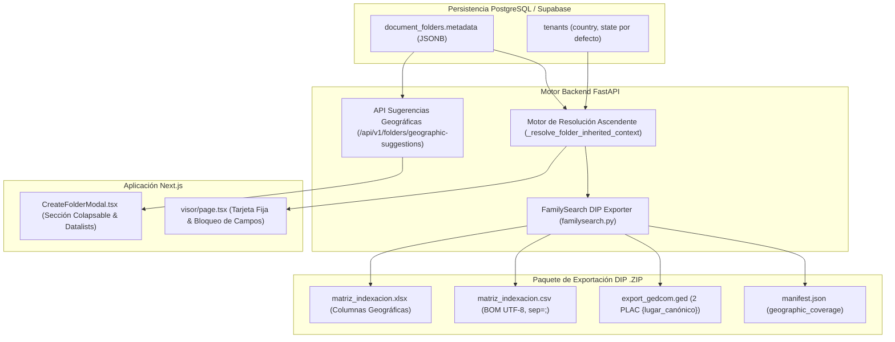
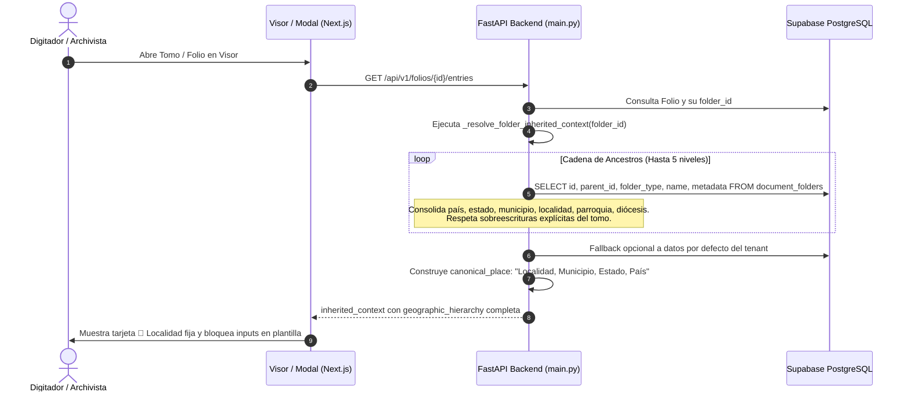

# Arquitectura Técnica y Plan de Implementación: Jerarquía Geográfica, Jurisdicción Territorial y Herencia de Localidad

**Identificador de Especificación:** `SPEC-013`  
**Fase SDD:** Paso 4 - Plan de Arquitectura Técnica  
**Estado:** Listo para Implementación  
**Autor:** Agente Planificador SDD  
**Fecha:** 2026-10-16  

---

## 1. Visión General y Objetivos Arquitectónicos

La especificación `SPEC-013` formaliza la captura, resolución contextual dinámica e interoperabilidad de datos geográficos y jurisdiccionales a lo largo de todo el árbol documental de CodexFlow. Cumple con los estándares internacionales de preservación genealógica y archivística: **FamilySearch Places Standard API**, **GEDCOM 5.5.1 (etiqueta `2 PLAC`)** y el principio de procedencia archivística **ISAD(G)**.

### 1.1 Objetivos Clave
1. **Captura Jerárquica Flexible:** Permitir la definición de jurisdicción geográfica y eclesiástica en cualquier nodo del árbol documental (`root`, `parish`, `series`, `tome`) a través del esquema JSONB `document_folders.metadata`.
2. **Motor de Resolución Ascendente Dinámico:** Algoritmo en backend (`backend/main.py`) que atraviesa la cadena de ancestros (`tome -> series -> parish -> root -> tenant`) resolviendo valores geográficos con soporte de **sobreescritura parcial** y consolidando la cadena canónica estándar internacional `f"{localidad}, {municipio}, {estado}, {pais}"`.
3. **Sugerencias y Autocompletado en Frontend:** Interfaz en `CreateFolderModal.tsx` con sección colapsable *"📍 Jurisdicción Territorial y Localidad Geográfica"*, datalists inteligentes basados en valores existentes de la organización y prellenado automático a partir del padre.
4. **Protección en el Visor de Indexación:** Enriquecimiento de la tarjeta superior en `visor/page.tsx` con la localidad canónica y candado de solo lectura, bloqueando campos equivalentes en la plantilla para evitar captura redundante.
5. **Enriquecimiento del Paquete DIP FamilySearch:** Incorporación de columnas geográficas individuales y consolidadas en `matriz_indexacion.xlsx` y `matriz_indexacion.csv`, etiquetado genealógico `2 PLAC` en `export_gedcom.ged` y ficha técnica `tome_info.geographic_coverage` en `manifest.json`.

---

## 2. Diagramas de Arquitectura y Flujos de Datos

### 2.1 Flujo Global de Resolución y Consumo Geográfico



### 2.2 Secuencia de Resolución Dinámica en Cascada (Sin Redundancia en BD)



---

## 3. Esquema de Metadatos y Modelo de Datos (JSONB)

En lugar de alterar tablas relacionales con migraciones de alto riesgo, se aprovecha el campo `metadata` JSONB de `document_folders` (definido en `SPEC-012`), extendiendo su contrato semántico y tipado.

### 3.1 Estructura del Objeto JSONB en `document_folders.metadata`

```json
{
  "tome_number": "1",
  "year_start": 1850,
  "year_end": 1875,
  "location": "Estante A - Caja 3",
  "template_id": "9b1deb4d-3b7d-4bad-9bdd-2b0d7b3dcb6d",
  "country": "Venezuela",
  "state": "Sucre",
  "municipality": "Bermúdez",
  "city_or_locality": "Carúpano",
  "diocese_name": "Diócesis de Carúpano",
  "parish_name": "Parroquia Santa Rosa de Lima"
}
```

### 3.2 Tipos TypeScript para el Frontend (`frontend/src/types/folders.ts`)

```typescript
export interface GeographicMetadata {
  country?: string;
  state?: string;
  municipality?: string;
  city_or_locality?: string;
  diocese_name?: string;
  parish_name?: string;
}

export interface FolderMetadata extends GeographicMetadata {
  tome_number?: string;
  year_start?: number;
  year_end?: number;
  location?: string;
  template_id?: string;
  is_virtual_unclassified?: boolean;
  [key: string]: any;
}

export interface InheritedGeographicContext {
  country: string | null;
  state: string | null;
  municipality: string | null;
  city_or_locality: string | null;
  diocese_name: string | null;
  parish_name: string | null;
  canonical_place: string | null; // "Localidad, Municipio, Estado, País"
  tome_number: string | null;
  year_start: number | null;
  year_end: number | null;
}
```

### 3.3 Modelos Pydantic en Backend (`backend/main.py`)

```python
class FolderMetadata(BaseModel):
    tome_number: Optional[str] = None
    year_start: Optional[int] = None
    year_end: Optional[int] = None
    location: Optional[str] = None
    template_id: Optional[str] = None
    # Dimensiones Geográficas y Eclesiásticas SPEC-013
    country: Optional[str] = None
    state: Optional[str] = None
    municipality: Optional[str] = None
    city_or_locality: Optional[str] = None
    diocese_name: Optional[str] = None
    parish_name: Optional[str] = None

class GeographicSuggestionsResponse(BaseModel):
    countries: List[str]
    states: List[str]
    municipalities: List[str]
    cities_or_localities: List[str]
    dioceses: List[str]
    parishes: List[str]
```

---

## 4. Motor de Resolución Contextual Ascendente (Backend)

### 4.1 Algoritmo de Resolución con Sobreescritura Parcial

El motor se implementa en la función `_resolve_folder_inherited_context` de `backend/main.py`. Realiza una búsqueda ascendente desde la carpeta del folio (`tome`), pasando por `series`, `parish`, `root` hasta el `tenant`.

#### Reglas de Prevalencia:
1. **Sobreescritura específica:** Si un nivel inferior (ej. `tome`) define explícitamente un campo (ej. `city_or_locality`), este valor prevalece sobre los ancestros.
2. **Herencia ascendente:** Si un campo está ausente o vacío (`None` o `""`), se busca recursivamente en el padre inmediato.
3. **Fallback institucional:** Si `country` o `state` no están en ningún nivel del árbol, se extraen de la configuración general de la organización en la tabla `tenants`.
4. **Construcción canónica FamilySearch:** Formato ordenado internacional:
   $$\text{canonical\_place} = \text{filtrar\_vacios}([\text{city\_or\_locality}, \text{municipality}, \text{state}, \text{country}]).join(", ")$$

```python
def build_canonical_place(city: Optional[str], municipality: Optional[str], state: Optional[str], country: Optional[str]) -> Optional[str]:
    parts = [p.strip() for p in (city, municipality, state, country) if p and isinstance(p, str) and p.strip()]
    return ", ".join(parts) if parts else None

def _resolve_folder_inherited_context(client: Client, folder_id: Optional[str], tenant_id: str) -> Dict[str, Any]:
    context = {
        "country": None,
        "state": None,
        "municipality": None,
        "city_or_locality": None,
        "diocese_name": None,
        "parish_name": None,
        "tome_number": None,
        "year_start": None,
        "year_end": None,
        "canonical_place": None
    }
    if not folder_id:
        # Fallback a organización
        _fill_tenant_geo_fallback(client, tenant_id, context)
        context["canonical_place"] = build_canonical_place(
            context["city_or_locality"], context["municipality"], context["state"], context["country"]
        )
        return context

    current_id = folder_id
    visited = set()

    for _ in range(8):  # Protección contra ciclos
        if not current_id or current_id in visited:
            break
        visited.add(current_id)

        res = client.table("document_folders").select("*").eq("id", current_id).eq("tenant_id", tenant_id).execute()
        if not res.data:
            break
        folder = res.data[0]
        meta = folder.get("metadata") or {}
        ftype = folder.get("folder_type")
        fname = folder.get("name")

        # Asignaciones estructurales por tipo
        if ftype == "tome":
            if not context["tome_number"]:
                context["tome_number"] = meta.get("tome_number") or meta.get("number") or fname
            if not context["year_start"]:
                context["year_start"] = meta.get("year_start") or meta.get("start_year")
            if not context["year_end"]:
                context["year_end"] = meta.get("year_end") or meta.get("end_year")
        elif ftype == "parish":
            if not context["parish_name"]:
                context["parish_name"] = meta.get("parish_name") or fname
        elif ftype == "root":
            if not context["diocese_name"]:
                context["diocese_name"] = meta.get("diocese_name") or fname

        # Campos geográficos jerárquicos (primero el más cercano a las hojas)
        for field in ("country", "state", "municipality", "city_or_locality", "diocese_name", "parish_name"):
            if not context[field] and meta.get(field):
                val = str(meta[field]).strip()
                if val:
                    context[field] = val

        current_id = folder.get("parent_id")

    # Fallback final a datos del tenant
    _fill_tenant_geo_fallback(client, tenant_id, context)

    # Consolidación de la cadena canónica estándar FamilySearch
    context["canonical_place"] = build_canonical_place(
        context["city_or_locality"], context["municipality"], context["state"], context["country"]
    )
    return context
```

---

## 5. Contratos de API REST (FastAPI)

### 5.1 Endpoint de Sugerencias de Localidades
Permite al frontend alimentar datalists para autocompletar mientras el usuario escribe, evitando discrepancias tipográficas.

#### `GET /api/v1/folders/geographic-suggestions`
- **Headers:** `Authorization: Bearer <token>`, `x-tenant-id: <uuid>` (opcional).
- **Descripción:** Escanea todos los registros de `document_folders.metadata` del inquilino y compila listas deduplicadas y ordenadas alfabéticamente de cada dimensión territorial.
- **Respuesta 200 OK:**
```json
{
  "status": "success",
  "data": {
    "countries": ["Venezuela", "Colombia"],
    "states": ["Sucre", "Nueva Esparta"],
    "municipalities": ["Bermúdez", "Arismendi", "Benítez"],
    "cities_or_localities": ["Carúpano", "Río Caribe", "El Pilar"],
    "dioceses": ["Diócesis de Carúpano", "Arquidiócesis de Cumaná"],
    "parishes": ["Parroquia Santa Rosa de Lima", "Parroquia San José", "Parroquia Santa Catalina"]
  }
}
```

### 5.2 Actualización de Respuesta en `GET /api/v1/folios/{folio_id}/entries`
Se extiende el payload retornado para entregar la localidad canónica y las dimensiones segregadas:
```json
{
  "status": "success",
  "folio_id": "c32a74c1-4835-4302-86db-a38f3cbff001",
  "inherited_context": {
    "country": "Venezuela",
    "state": "Sucre",
    "municipality": "Bermúdez",
    "city_or_locality": "Carúpano",
    "diocese_name": "Diócesis de Carúpano",
    "parish_name": "Parroquia Santa Rosa de Lima",
    "canonical_place": "Carúpano, Bermúdez, Sucre, Venezuela",
    "tome_number": "1",
    "year_start": 1850,
    "year_end": 1875
  },
  "inherited_tome_metadata": {
    "diocese": "Diócesis de Carúpano",
    "parish": "Parroquia Santa Rosa de Lima",
    "locality": "Carúpano, Bermúdez, Sucre, Venezuela",
    "series": "Bautismos",
    "tome": "1",
    "years_range": "1850-1875"
  },
  "entries": [...]
}
```

---

## 6. Diseño de Componentes Frontend

### 6.1 Modal de Creación y Edición (`frontend/src/components/folders/CreateFolderModal.tsx`)

#### Características Principales:
1. **Sección Colapsable:**
   - Botón toggle estilizado con badge de estado: `"📍 Jurisdicción Territorial y Localidad Geográfica"` con icono `ChevronDown` / `ChevronUp`.
   - Abierto por defecto cuando el tipo es `root` o `parish`; colapsado opcional cuando es `series` o `tome`.
2. **Inputs con Autocompletado / Datalists:**
   - `<input list="country-suggestions" ... />`
   - `<datalist id="country-suggestions">` alimentado por el hook `useGeographicSuggestions`.
3. **Prellenado Automático del Padre:**
   - Al abrir el modal para crear un hijo (`parentFolder` presente), los inputs de país, estado y municipio se preinicializan con los valores heredados del padre, facilitando la sobreescritura específica si difieren.
4. **Campos Disponibles en el Formulario:**
   - `country`: País (ej. Venezuela)
   - `state`: Estado / Provincia / Departamento (ej. Sucre)
   - `municipality`: Municipio / Cantón (ej. Bermúdez)
   - `city_or_locality`: Ciudad / Parroquia Civil / Localidad (ej. Carúpano)
   - `diocese_name`: Diócesis / Jurisdicción Eclesiástica (ej. Diócesis de Carúpano)
   - `parish_name`: Parroquia Eclesiástica (ej. Parroquia Santa Rosa de Lima)

### 6.2 Visor de Indexación (`frontend/src/app/[subdomain]/visor/page.tsx`)

#### 1. Tarjeta Informativa Compacta con Candado:
- Se reemplaza la tarjeta gris actual por una tarjeta de contexto enriquecida:
```tsx
<div className="bg-slate-50 border border-slate-200 rounded-lg p-3 text-xs text-slate-700 flex items-center justify-between shadow-xs mb-4">
  <div className="flex items-center gap-2.5 overflow-hidden">
    <div className="p-1.5 bg-blue-100/80 text-blue-700 rounded-md shrink-0">
      <MapPin className="w-4 h-4" />
    </div>
    <div className="truncate">
      <div className="flex items-center gap-1.5">
        <span className="font-semibold text-slate-900">
          📍 Localidad: {inheritedContext.canonical_place || "No asignada"}
        </span>
        <Lock className="w-3.5 h-3.5 text-slate-400" />
      </div>
      <div className="text-[11px] text-slate-500 mt-0.5 truncate">
        {[
          inheritedContext.parish_name,
          inheritedContext.diocese_name,
          inheritedContext.tome_number ? `Tomo ${inheritedContext.tome_number}` : null,
          inheritedContext.year_start || inheritedContext.year_end 
            ? `Años: ${inheritedContext.year_start || "?"}-${inheritedContext.year_end || "?"}` 
            : null
        ].filter(Boolean).join(" | ")}
      </div>
    </div>
  </div>
  <span className="text-[10px] uppercase font-mono tracking-wider text-slate-600 bg-slate-200 px-2 py-0.5 rounded shrink-0">
    Heredado
  </span>
</div>
```

#### 2. Bloqueo de Campos Redundantes en Plantilla (`getInheritedFieldInfo`):
La función detecta nombres de campos de la plantilla y los deshabilita (`readOnly / disabled`) inyectando el valor heredado y la etiqueta informativa:
- Nombres detectados:
  - `lugar`, `place`, `lugar_suceso`, `lugar_bautismo`, `lugar_evento` $\rightarrow$ `canonical_place`
  - `pais`, `country`, `nacion` $\rightarrow$ `country`
  - `estado`, `state`, `provincia`, `departamento` $\rightarrow$ `state`
  - `municipio`, `municipality`, `canton` $\rightarrow$ `municipality`
  - `ciudad`, `localidad`, `city`, `pueblo` $\rightarrow$ `city_or_locality`
  - `parroquia`, `parish` $\rightarrow$ `parish_name`
  - `diocesis`, `diocese` $\rightarrow$ `diocese_name`

---

## 7. Motor de Exportación FamilySearch DIP

### 7.1 Matriz Tabular (`matriz_indexacion.xlsx` y `matriz_indexacion.csv`)

Se incorporan cinco columnas geográficas al formato tabular generado por `generate_familysearch_matrix` en `backend/exporters/familysearch.py`:

#### Nuevas Columnas:
1. `pais`
2. `estado`
3. `municipio`
4. `ciudad_localidad`
5. `lugar_evento_estandarizado` (cadena canónica `Localidad, Municipio, Estado, País`)

```python
headers = [
    "image_file_name",
    "folio_number",
    "entry_number",
    "status",
    "primer_nombre",
    "apellidos",
    "sexo",
    "fecha_acta",
    "fecha_nacimiento",
    "nombre_padre",
    "nombre_madre",
    "conyuge",
    "padrinos",
    "parroquia",
    "tomo",
    # Nuevas columnas geográficas SPEC-013
    "pais",
    "estado",
    "municipio",
    "ciudad_localidad",
    "lugar_evento_estandarizado",
    "observaciones_calidad"
]
```

### 7.2 Archivo Genealógico GEDCOM 5.5.1 (`export_gedcom.ged`)

En `generate_gedcom_551`, la etiqueta `2 PLAC` utiliza el lugar canónico estandarizado:
```gedcom
1 CHR
2 DATE 15 APR 1855
2 PLAC Carúpano, Bermúdez, Sucre, Venezuela
```

#### Manejo de Casos Límite:
- Si `canonical_place` está definido, se emite `2 PLAC {canonical_place}` en eventos vitales (`BIRT`, `CHR`, `MARR`, `DEAT`).
- Si ningún nivel define localidad pero la organización tiene país/estado por defecto, se utiliza este fallback.
- Si no existe ningún dato geográfico, **se omite completamente la línea `2 PLAC`**, preservando la validez sintáctica del estándar GEDCOM 5.5.1 sin emitir etiquetas vacías ni datos ficticios.

### 7.3 Manifiesto Institucional de Preservación (`manifest.json`)

En `generate_manifest_json`, se enriquece `tome_info` con el nodo `geographic_coverage`:
```json
{
  "tome_info": {
    "id": "e4a7a58a-3652-4752-a521-cb2b88880004",
    "name": "Libro 01 (1850-1875)",
    "folder_type": "tome",
    "tome_number": "1",
    "year_start": 1850,
    "year_end": 1875,
    "parish_name": "Parroquia Santa Rosa de Lima",
    "diocese_name": "Diócesis de Carúpano",
    "geographic_coverage": {
      "country": "Venezuela",
      "state": "Sucre",
      "municipality": "Bermúdez",
      "city_or_locality": "Carúpano",
      "standardized_place": "Carúpano, Bermúdez, Sucre, Venezuela",
      "is_partially_inherited": true
    }
  }
}
```

### 7.4 Auditoría Previa de Exportación (`pre-export-summary`)
El endpoint `GET /api/v1/folders/{folder_id}/pre-export-summary` evalúa la completitud geográfica:
- Si el tomo carece de `country` o `state`, agrega una advertencia informativa (`warnings: ["Localidad geográfica incompleta: se recomienda definir al menos País y Estado antes de enviar a FamilySearch"]`).
- **No bloquea la exportación**, permitiendo la descarga según la Decisión #5 de la especificación.

---

## 8. Estrategia de Rendimiento, Seguridad e Integridad

1. **Eficiencia en Búsqueda Ascendente:**
   - Profundidad máxima acotada a 8 iteraciones para evitar bucles o latencia innecesaria.
   - Conjunto `visited` para prevenir referencias circulares en caso de inconsistencia en base de datos.
2. **Consultas Agregadas de Sugerencias:**
   - La API de sugerencias geográficas utiliza agregaciones deduplicadas `DISTINCT` sobre las claves del JSONB, aprovechando índices GIN en `metadata` si la volumetría crece.
3. **Aislamiento Multi-Inquilino (RLS):**
   - Todas las consultas de ancestros y sugerencias se filtran estrictamente por `tenant_id = auth.tenant_id`.
4. **Retroactividad Automática en Memoria:**
   - Ninguna partida almacena la localidad duplicada en su registro individual. Al consultar o exportar, la resolución dinámica recalcula la jerarquía actual, garantizando que actualizaciones en el padre apliquen inmediatamente a miles de folios sin requerir migraciones por lotes.

---

## 9. Plan de Pruebas y Validación de Calidad (QA)

| ID Prueba | Escenario de Prueba | Resultado Esperado |
| :--- | :--- | :--- |
| **QA-GEO-01** | Herencia total desde la raíz | Tomo sin metadata geográfica hereda País, Estado y Diócesis definidos en la Diócesis raíz. |
| **QA-GEO-02** | Sobreescritura parcial en tomo | Tomo define `city_or_locality: "Playa Grande"`. La cadena canónica resulta `"Playa Grande, Bermúdez, Sucre, Venezuela"`. |
| **QA-GEO-03** | Mover tomo a otra parroquia | Al cambiar `parent_id` de Parroquia A a Parroquia B, la localidad se recalcula automáticamente con los datos de Parroquia B. |
| **QA-GEO-04** | Bloqueo en Visor | En una plantilla con campo `Lugar del Bautismo`, el input se renderiza inhabilitado con el valor canónico y tooltip de candado. |
| **QA-GEO-05** | Validación GEDCOM 5.5.1 | El archivo `.ged` exportado pasa validación sintáctica estricta conteniendo `2 PLAC Carúpano, Bermúdez, Sucre, Venezuela`. |
| **QA-GEO-06** | Caso límite sin localidad | Tomo sin datos geográficos en ningún nivel genera GEDCOM válido omitiendo `2 PLAC` sin fallar. |
| **QA-GEO-07** | Consistencia Excel y CSV | Las 5 columnas geográficas en `.xlsx` y `.csv` coinciden exactamente con la metadata del manifiesto. |
