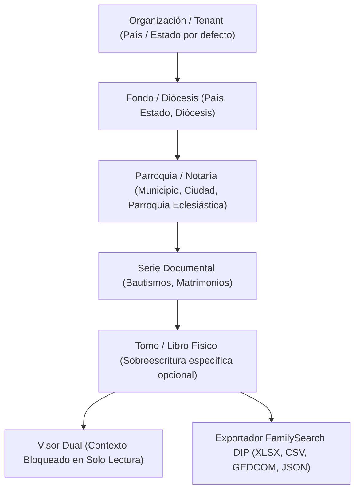

# SPEC-013: Jerarquía Geográfica, Jurisdicción Territorial y Herencia de Localidad en Carpetas y Exportación FamilySearch

## 1. Visión General y Propósito
El estándar genealógico internacional de FamilySearch (Places Standard API, GEDCOM 5.5.1 y normas archivísticas ISAD(G)) exige que cada evento y documento esté catalogado con su contexto territorial completo:
$$\text{País} \rightarrow \text{Estado / Provincia} \rightarrow \text{Municipio / Cantón} \rightarrow \text{Ciudad / Parroquia Civil / Localidad} \rightarrow \text{Jurisdicción Eclesiástica (Diócesis / Parroquia)}$$

Esta especificación formaliza la captura de datos de localidad en cualquier nivel del árbol de carpetas, el motor de herencia en cascada hacia tomos y folios, la visualización en el Visor de Indexación con bloqueo en solo lectura y la exportación interoperable en los paquetes DIP de FamilySearch (Excel, CSV, GEDCOM 5.5.1 y `manifest.json`).

---

## 2. Decisiones Técnicas Acordadas (Triple Filtro QA - 15 Clarificaciones)

1. **Entrada de datos:** Texto abierto con autocompletado y sugerencias dinámicas basadas en los valores previamente usados en la organización.
2. **Mecánica de cascada:** Resolución dinámica en tiempo real. Si se edita una carpeta padre, todos los tomos y folios hijos heredan los nuevos valores al instante.
3. **Formato estándar FamilySearch (`2 PLAC`):** Orden jerárquico ascendente estándar internacional: `'Localidad, Municipio, Estado, País'` (ej. `'Carúpano, Bermúdez, Sucre, Venezuela'`).
4. **Interacción en el Visor:** Tarjeta fija en el panel derecho superior con candado de solo lectura e icono 📍. Bloquea campos equivalentes en la plantilla evitando tipeo redundante.
5. **Validación en exportación DIP:** Si un tomo no tiene localidad completa, se permite la exportación emitiendo un aviso informativo en el resumen de auditoría sin bloquear la descarga.
6. **Almacenamiento en BD:** Almacenado de forma ágil y flexible dentro de `document_folders.metadata` JSONB (`country`, `state`, `municipality`, `city_or_locality`, `diocese_name`, `parish_name`).
7. **Nivel del árbol:** Formulario disponible en todos los niveles (`root`, `parish`, `series`, `tome`).
8. **Manejo de sobreescritura:** Herencia jerárquica con sobreescritura parcial: un tomo puede redefinir Municipio o Localidad conservando el País y Estado del padre.
9. **Matriz de Exportación:** Columnas individuales desglosadas (`pais`, `estado`, `municipio`, `ciudad_localidad`) más la columna consolidada de lugar estandarizado (`lugar_evento_estandarizado`).
10. **Caso límite GEDCOM:** Si un documento no tiene localidad en ningún nivel, busca en el perfil de la organización; si no existe, omite la etiqueta `2 PLAC` de forma segura sin romper la sintaxis.
11. **Diseño de Interfaz:** Sección colapsable estilizada `'📍 Jurisdicción y Localidad'` en `CreateFolderModal.tsx`.
12. **Ubicación en el Visor:** Encabezado superior del panel de indexación en tarjeta informativa compacta.
13. **Movimiento en el Árbol:** Al mover un tomo a otra parroquia padre, su localidad heredada se recalcula al vuelo respetando únicamente los campos sobreescritos explícitamente en el tomo.
14. **Retroactividad:** Resolución dinámica en memoria al abrir o exportar; todos los folios y partidas históricas heredan la localidad actual del tomo inmediatamente.
15. **Manifiesto de auditoría:** Ficha técnica estructurada en `manifest.json` bajo `tome_info.geographic_coverage`.

---

## 3. Modelo de Herencia Jerárquica

