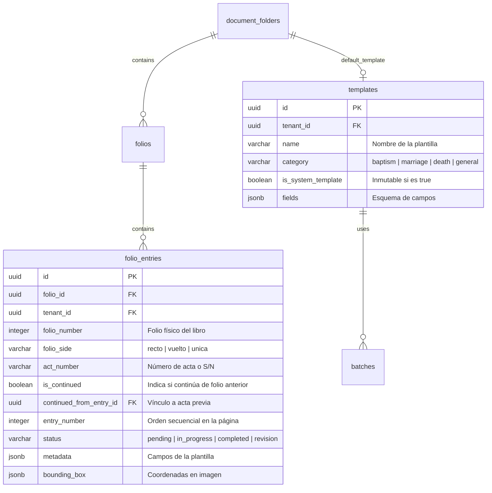
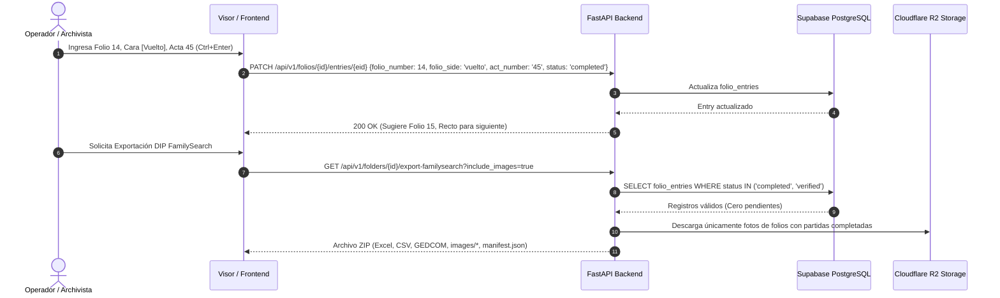

# PLAN-014: Estándar Archivístico, Foliación Recto/Vuelto, Plantillas Maestras FamilySearch y Filtro Estricto DIP

## 1. Resumen Ejecutivo y Objetivos Técnicos
Este plan técnico detalla la arquitectura, modelo de datos, flujos de API y experiencia de usuario (UI/UX) para implementar los estándares archivísticos canónicos de **FamilySearch** y archivos diocesanos/civiles históricos en **CodexFlow**:
1. **Foliación Tridimensional y Manejo de Caras (Recto/Vuelto):**
   - Incorporar en `folio_entries` los campos `folio_number`, `folio_side` (`'recto'`, `'vuelto'`, `'unica'`), `act_number` e `is_continued`.
   - Selector interactivo bimembre `[ Recto (Frente) ]` / `[ Vuelto (Espalda) ]` en el visor de transcripción.
   - Avance ergonómico mediante `Ctrl + Enter` con alternancia inteligente de caras (de 'recto' a 'vuelto', o incremento de folio físico al estar en 'vuelto').
   - Alerta visual no bloqueante ante saltos de foliación física.
   - Soporte para actas continuadas interfolio consolidadas como una entidad unificada en las matrices exportadas.
2. **Plantillas Maestras Oficiales FamilySearch Inmutables:**
   - 3 plantillas precargadas del sistema (`is_system_template: true`) no eliminables ni editables en sus campos base (pero duplicables): *Bautismo / Nacimiento*, *Matrimonio* (con desagregación de contrayentes y enlace por acta/folio), y *Defunción / Entierro*.
3. **Filtro Estricto de Exportación DIP FamilySearch:**
   - Exclusión radical de registros en estado `pending` en `matriz_indexacion.xlsx`, CSV y `export_gedcom.ged`.
   - Empaquetamiento condicional de imágenes: si `include_images=True`, solo incluir en `images/` fotos con al menos un acta completada (`completed` o `verified`), con nomenclatura canónica que exprese foliación física real (ej. `CARUPANO_BAU_T01_F014R.jpg`).
   - Bloqueo preventivo en UI con aviso si el tomo posee 0 actas completadas.
   - Auditoría en `manifest.json` reportando folios pendientes omitidos.
4. **Reparación y Optimización del Explorador de Registros (`/records`):**
   - Resolución de la consulta indefinida mediante desacoplamiento y paginación en backend (`folio_entries` completadas indexadas con información de tomo, folio y persona).
   - Búsqueda reactiva por texto libre y filtros con respuesta sub-segundo.
5. **Tooling Aislado para Demo Data:**
   - Script independiente en `tools/seeding/seed_demo_data.py` sin impacto en el build de producción.

---

## 2. Arquitectura del Modelo de Datos

### 2.1 Migración de Base de Datos (`folio_entries`)
Campos a extender en `public.folio_entries`:
- `folio_number`: `INTEGER NULL` (Número físico rotulado en el libro).
- `folio_side`: `VARCHAR(10) DEFAULT 'recto' CHECK (folio_side IN ('recto', 'vuelto', 'unica'))`.
- `act_number`: `VARCHAR(50) DEFAULT 'S/N'`.
- `is_continued`: `BOOLEAN DEFAULT FALSE`.
- `continued_from_entry_id`: `UUID REFERENCES folio_entries(id) ON DELETE SET NULL`.
- Índices de optimización:
  - `idx_folio_entries_status_tenant`: `(tenant_id, status)` para el filtro estricto DIP y `/records`.
  - `idx_folio_entries_lookup`: `(folio_id, folio_number, act_number)`.

### 2.2 Migración de Plantillas de Sistema (`templates`)
- Campo `is_system_template`: `BOOLEAN DEFAULT FALSE` en la tabla `templates`.
- Definición canónica inmutable de las 3 plantillas maestras FamilySearch:
  1. **Bautismo / Nacimiento FamilySearch:**
     - `first_name`, `last_name`, `sex`, `birth_date`, `event_date` (Bautismo), `birth_place`, `father_name`, `father_origin`, `mother_name`, `mother_origin`, `paternal_grandfather`, `paternal_grandmother`, `maternal_grandfather`, `maternal_grandmother`, `godfather`, `godmother`, `witnesses`, `minister`, `marginal_notes`.
  2. **Matrimonio FamilySearch:**
     - `event_date` (Matrimonio), `groom_first_name`, `groom_last_name`, `groom_age`, `groom_marital_status`, `groom_origin`, `groom_father`, `groom_mother`, `bride_first_name`, `bride_last_name`, `bride_age`, `bride_marital_status`, `bride_origin`, `bride_father`, `bride_mother`, `godparents`, `witnesses`, `minister`, `marginal_notes`.
  3. **Defunción / Entierro FamilySearch:**
     - `death_date`, `burial_date`, `first_name`, `last_name`, `sex`, `age`, `death_cause`, `marital_status`, `spouse_name`, `father_name`, `mother_name`, `cemetery_location`, `minister`, `marginal_notes`.

---

## 3. Flujos de Backend y Endpoints de API

### 3.1 Endpoint de Partidas en Visor
- `POST /api/v1/folios/{folio_id}/entries`: Admite `folio_number`, `folio_side`, `act_number`, `is_continued`, `continued_from_entry_id`.
- `PATCH /api/v1/folios/{folio_id}/entries/{entry_id}`: Permite actualizar foliación y estado.

### 3.2 Endpoint de Exportación DIP (`export-familysearch`)
- **Filtro Estricto:** Ejecuta consulta con `.in_("status", ["completed", "verified"])`. Si el conteo es cero, aborta con `400 Bad Request` indicando que no hay actas terminadas para empaquetar.
- **Nomenclatura Canónica de Imágenes con Cara:**
  - Si el folio tiene `folio_number` y `folio_side`: se computa `F{folio_number:03d}{R|V}` (ej. `CARUPANO_BAU_T01_F014R.jpg`).
- **Consolidación de Partidas Continuadas:**
  - Cuando `is_continued: true`, los campos de notas y texto se unen al registro matriz inicial en `matriz_indexacion.xlsx`, CSV y GEDCOM, referenciando la imagen de origen.
- **Manifiesto:** Incluye `total_tome_folios`, `exported_entries_count`, `excluded_pending_folios` y `quality_score`.

### 3.3 Reparación de `/api/v1/records`
- Desacoplar la consulta pesada y evitar bucles en folios completos:
  - Cambiar la fuente principal de datos para consultar directamente `folio_entries` completadas unidas con `folios` y `document_folders` (o consultar `folios` con paginación `range(offset, offset + page_size - 1)` sin cargar la colección entera en memoria antes de paginar).
  - Incluir campos de foliación archivística física en la respuesta (`folio_number`, `folio_side`, `act_number`, nombre del titular extraído).

---

## 4. Diseño de Interfaz de Usuario (UI/UX)

1. **Barra de Foliación en el Visor de Transcripción (`TranscriptionPanel.tsx` / `Visor`):**
   - Grupo de control superior:
     - Input numérico: `Folio Físico` (ej. `14`).
     - Selector tipo toggle bimembre:
       - `[ Recto (Frente) ]` (Activo con clase visual azul/esmeralda).
       - `[ Vuelto (Espalda) ]` (Activo con clase visual azul/esmeralda).
     - Input texto: `Acta N°` (con checkbox `[ ] S/N`).
     - Switch de excepción: `[ ] Partida continuada de folio anterior`.
   - Atajo de teclado `Ctrl + Enter`:
     - Guarda la partida actual como `completed`.
     - Si estaba en `Recto`, conmuta automáticamente a `Vuelto` manteniendo el mismo `folio_number`.
     - Si estaba en `Vuelto`, avanza a `Recto` e incrementa `folio_number + 1`.
     - Si se detecta un salto numérico (ej. de 12v a 14r), despliega un badge ámbar no bloqueante: *"Aviso: Salto de folio detectado (F.12v -> F.14r). Página faltante o numeración irregular."*
2. **Modal de Exportación DIP (`ExportFamilySearchModal.tsx`):**
   - Inspección previa con `pre-export-summary`:
     - Muestra: *Total folios*, *Actas completadas a exportar*, *Páginas pendientes excluidas*.
     - Botón `Descargar Paquete DIP` deshabilitado si `completed_entries === 0` con alerta informativa clara.
3. **Explorador de Registros (`/records`):**
   - Tabla estilizada mostrando:
     - Titular / Persona Principal.
     - Sacramento / Tipo de Registro.
     - Tomo y Folio Físico con Cara (ej. *T.01 - F.14r*).
     - Número de Acta (ej. *Acta 45*).
     - Fecha del Sacramento y Fecha de Nacimiento/Defunción.
     - Estado (`Completado` / `Verificado`).
   - Paginación instantánea y filtrado por texto sin colapsar el hilo del navegador.

---

## 5. Tooling de Demostración (`tools/seeding/seed_demo_data.py`)
- Script CLI modular en Python que utiliza `SUPABASE_SERVICE_ROLE_KEY`.
- Genera un lote de prueba para una organización con 1 tomo de Bautismos, 10 folios físicos correlativos con caras Recto y Vuelto, y 25 actas en diversos estados (`completed`, `verified`, `pending`) para validar el filtrado estricto.

---

## 6. Verificación y Criterios de Aceptación
1. **Foliación:** Comprobar que al alternar Recto/Vuelto y usar `Ctrl + Enter`, los campos se persisten adecuadamente en base de datos.
2. **Plantillas Maestras:** Verificar que las 3 plantillas tienen `is_system_template = true` y no pueden ser borradas ni desconfiguradas por usuarios comunes.
3. **DIP Exporter:**
   - Exportar con 0 registros completados -> Respuesta 400 y botón deshabilitado.
   - Exportar con folios mixtos -> `matriz_indexacion.xlsx`, CSV y GEDCOM contienen exactamente el total de completados (0 filas pendientes), y la carpeta `images/` excluye fotos pendientes.
4. **Rendimiento `/records`:** Carga completa en < 1 segundo con paginador funcional.
