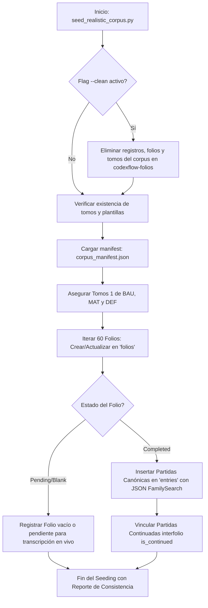

# Plan de Arquitectura Técnica - SPEC-015: Corpus Paleográfico Realista, Variantes de Estrés Archivístico y Dataset de Entrenamiento

## 1. Visión General y Objetivos Técnicos
Este plan operacionaliza la generación, aprovisionamiento y persistencia de un corpus paleográfico sintético de 60 folios sacrosantos (siglos XIX: 1885-1895) de alta resolución, estructurados canónicamente para someter a prueba de estrés el SaaS CodexFlow, su Visor Dual, su Árbol de Ingesta, y las herramientas de exportación FamilySearch/DIP.

### Metas Principales:
1. **Volumen Canónico**: 60 folios divididos estrictamente en 3 Tomos (20 Bautismos, 20 Matrimonios, 20 Defunciones).
2. **Estructura Documental**: 3 Libros oficiales asignados a la organización `codexflow-folios` con sus respectivas plantillas oficiales.
3. **Casuística de Estrés Archivístico Real**:
   - Aperturas dobles de libro (2 páginas en una sola toma fotográfica).
   - Partidas continuadas interfolio con enlace `is_continued = true` y `continued_from_entry_id`.
   - Patologías documentales: Tinta desvaída, manchas de humedad, oxidación ferrogálica para validar Lupa interactiva (`L`), contraste y filtros.
   - Entradas dudosas o mutiladas (`Ctrl + U` y flag de dudoso).
   - Folios en blanco o notas de apertura/cierre (`Ctrl + B`).
   - Notas marginales (matrimonio, legitimación, dispensas episcopales).
4. **Balance Operativo**: 50% completadas (30 folios con registros genealógicos y JSON canónico perfecto) y 50% pendientes (30 folios para transcripción en vivo).
5. **Tooling Aislado e Idempotente**: Scripts en `tools/seeding/` con soporte `--clean` sin contaminar dependencias de producción.

---

## 2. Arquitectura de Datos y Estructura en Supabase / Postgres

### 2.1. Organización y Tomos en Árbol
- **Organización**: `codexflow-folios`
- **Estructura Jerárquica**:
  ```
  codexflow-folios (Org)
  ├── Tomo 1: Libro 1 de Bautismos (1885-1890) -> Plantilla: BAUTISMO_CANONICO
  │   └── 20 Folios (F001 a F020, Caras R/V)
  ├── Tomo 1: Libro 1 de Matrimonios (1885-1895) -> Plantilla: MATRIMONIO_CANONICO
  │   └── 20 Folios (F001 a F020, Caras R/V)
  └── Tomo 1: Libro 1 de Defunciones (1885-1892) -> Plantilla: DEFUNCION_CANONICA
      └── 20 Folios (F001 a F020, Caras R/V)
  ```

### 2.2. Esquema Relacional de Entidades
1. **`folios`**:
   - `id`: UUID (Primary Key).
   - `volume_id`: UUID (FK a `volumes`).
   - `folio_number`: Integer (1 a 20 por tomo).
   - `side`: Enum ('recto', 'verso', 'double_page', 'unica').
   - `image_url`: Text (R2 / Cloudflare Storage URL o Supabase Storage).
   - `status`: Enum ('pending', 'in_progress', 'completed', 'blank').
   - `metadata`: JSONB (flags de estrés: `has_marginal_notes`, `is_double_page`, `stress_factors`, `degradation_type`).
   - `is_blank`: Boolean (para folios `Ctrl + B`).

2. **`entries` / `sacramental_records`**:
   - `id`: UUID (Primary Key).
   - `folio_id`: UUID (FK a `folios`).
   - `entry_number`: Integer (número de partida en el libro/folio).
   - `entry_type`: Enum ('bautismo', 'matrimonio', 'defuncion').
   - `transcription_status`: Enum ('pending', 'completed', 'doubtful').
   - `is_continued`: Boolean (marca de partida continuada interfolio).
   - `continued_from_entry_id`: UUID nullable (referencia a la partida iniciada en folio anterior).
   - `continued_in_entry_id`: UUID nullable (referencia al folio subsiguiente).
   - `has_marginal_notes`: Boolean.
   - `marginal_notes_text`: Text nullable.
   - `canonical_data`: JSONB (estructurado conforme a las especificaciones canónicas de FamilySearch):
     - Bautismo: bautizado, fecha_bautismo, fecha_nacimiento, padres, abuelos paternos/maternos, padrinos, ministro.
     - Matrimonio: contrayentes (novio, novia), fechas, padres de ambos, testigos, ministro, dispensas (proclamas).
     - Defunción: difunto, edad, estado civil, cónyuge, causa_muerte, sacramentos administrados, sepultura.
   - `unreadable_fields`: Array of Strings (campos marcados con `<Ilegible>` o dudosos).

---

## 3. Matriz de Distribución de Casuística por Tomo (20 Folios c/u)

Cada tomo de 20 folios se diseña con una curva de calibración archivística balanceada:

| Rango de Folio | Tipo de Cara / Modo | Condición Archivística / Estrés | Estado | Propósito de Prueba / Validación |
| :--- | :--- | :--- | :--- | :--- |
| **F001R - F005V** (1-5) | Recto / Verso estándar | Caligrafía cursiva nítida, conservación óptima | `completed` (100% canónico) | Exportación limpia DIP, Excel, CSV, GEDCOM |
| **F006R - F007V** (6-7) | Apertura Doble (`double_page`) | 2 páginas en 1 sola toma fotográfica (toma de apertura) | `completed` (F6) / `pending` (F7) | Transcripción dual, navegación multipágina |
| **F008V -> F009R** (8-9) | Continuación Interfolio | Partida inicia al pie del F008V y concluye en F009R (`is_continued`) | `completed` | Enlace relacional `continued_from_entry_id` |
| **F010R - F012V** (10-12) | Recto / Verso | Tinta desvaída, manchas de humedad, oxidación ligera | `pending` | Lupa interactiva (`L`), contraste, inversión de color |
| **F013R - F014V** (13-14) | Recto / Verso | Mutilación parcial de bordes, nombres con tinta corrida | `pending` | Atajo `Ctrl + U` (`<Ilegible>`), botón *Marcar Dudoso* |
| **F015R** (15) | Recto | Folio en blanco con auto de visita pastoral / apertura anual | `blank` | Atajo `Ctrl + B` (*Folio en blanco/sin partidas*) |
| **F016R - F017V** (16-17) | Recto con Nota Marginal | Notas marginales densas al margen izquierdo (matrimonio / dispensa) | `completed` | Captura de notas marginales e indexación cruzada |
| **F018R - F020V** (18-20) | Recto / Verso estándar | Documento histórico regular del siglo XIX | `pending` | Práctica libre y transcripción interactiva en vivo |

**Resumen por Tomo**:
- 10 Folios completados (`completed`) con registros y metadatos genealógicos exactos.
- 10 Folios pendientes (`pending` o `blank` verificado) listos para demostraciones en vivo.
- Total general: 30 Folios completados + 30 Folios pendientes = 60 Folios.

---

## 4. Convención Canónica de Nomenclatura y Almacenamiento

### 4.1. Formato de Nomenclatura de Archivos
`[ORG]_[SERIE]_T[NUM]_F[FOLIO][CARA].[ext]`

- `[ORG]`: `CARUPANO`
- `[SERIE]`: `BAU` (Bautismos), `MAT` (Matrimonios), `DEF` (Defunciones)
- `T[NUM]`: `T01`
- `F[FOLIO]`: `F001` a `F020`
- `[CARA]`:
  - `R`: Recto
  - `V`: Verso (Vuelto)
  - `DP`: Doble Página (Apertura)
  - `U`: Única (Expediente suelto)

**Ejemplos**:
- `CARUPANO_BAU_T01_F001R.jpg`
- `CARUPANO_BAU_T01_F006DP.jpg` (Apertura doble)
- `CARUPANO_MAT_T01_F008V.jpg`
- `CARUPANO_DEF_T01_F015R.jpg`

### 4.2. Estrategia de Almacenamiento en Cloudflare R2 / Storage
- **Bucket/Path**: `codexflow-folios/corpus/`
- **Subdirectorios lógicos**:
  - `corpus/bautismos/`
  - `corpus/matrimonios/`
  - `corpus/defunciones/`
- Servido mediante CDN optimizado con cabeceras `Cache-Control: public, max-age=31536000, immutable`.

---

## 5. Diseño del Pipeline y Tooling de Seeding

### 5.1. Componentes del Tooling en `tools/seeding/`
1. `tools/seeding/corpus_manifest.json`:
   - Archivo de definición declarativa que especifica los 60 folios, sus atributos de estrés, números de partida, datos genealógicos de las partidas completadas y rutas de archivo.
2. `tools/seeding/upload_corpus_to_r2.py`:
   - Lee el manifest, verifica las imágenes generadas localmente y las sincroniza hacia el bucket de Cloudflare R2 / Storage configurado en variables de entorno (`R2_BUCKET_NAME`, `R2_ACCESS_KEY_ID`, `R2_SECRET_ACCESS_KEY`, `R2_ENDPOINT_URL`).
3. `tools/seeding/seed_realistic_corpus.py`:
   - Orquestador idempotente.
   - Opciones CLI:
     - `--clean`: Purga registros y folios anteriores creados por el corpus de prueba en la organización `codexflow-folios` sin alterar datos de otros clientes.
     - `--type [bautismo|matrimonio|defuncion|all]`: Permite sembrar una serie individual o el corpus completo.
     - `--count [10|20]`: Permite modular el volumen si se requiere una prueba rápida.
     - `--dry-run`: Valida la integridad del manifest y URLs sin escribir en la base de datos.

### 5.2. Flujo de Ejecución Idempotente


---

## 6. Consideraciones de Seguridad y Rendimiento
- **Aislamiento**: Ninguna imagen pesada se incluirá en el repositorio Git principal ni en los bundles estáticos de la aplicación web. El manifest guardará URLs remotas o archivos locales en `.gitignore` (`tools/seeding/corpus_images/`).
- **Idempotencia**: La combinación `(volume_id, folio_number, side)` actúa como restricción única en la base de datos para prevenir duplicación accidental.
- **Transaccionalidad**: La inserción por tomo se encapsula en transacciones para garantizar consistencia atómica.
