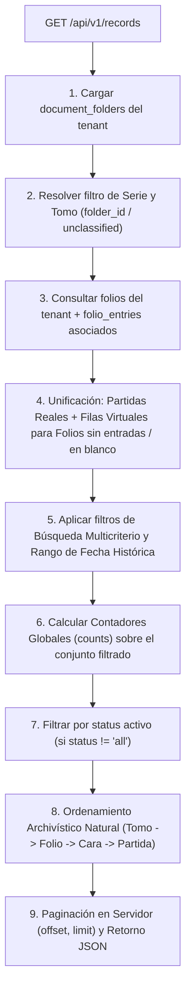

# Plan de Arquitectura Técnica — SPEC-016: Rediseño Jerárquico del Explorador de Registros (`/records`), Filtrado por Tomos/Carpetas y Visibilidad Multi-Estado

## 1. Resumen Arquitectónico
Este plan detalla la arquitectura de software necesaria para transformar el Explorador de Registros (`/[subdomain]/records`) de una vista plana limitada a lotes completados hacia una consola de control archivístico integral y multi-estado.

El rediseño resuelve tres cuellos de botella fundamentales:
1. **Navegación Jerárquica Documental (`Serie ➔ Tomo`):** Sustitución del selector obsoleto de `batch_id` por selectores en cascada sincronizados con el árbol de `document_folders` (`Serie / Carpeta Documental` y `Tomo / Libro`, incluyendo soporte explícito para `"Sin Clasificar"`).
2. **Visibilidad Total de Estados y Contadores en Vivo:** Eliminación de la restricción rígida `.in_("status", ["completed", "verified"])` en `GET /api/v1/records`. Unificación de partidas indexadas (`folio_entries`) con folios aún sin entradas o declarados en blanco (`folios`), garantizando que el 100% del acervo documental sea auditable y filtrable mediante una barra superior de tarjetas de estado interactivas (`Todos`, `Completados`, `Verificados`, `Pendientes`, `Dudosos / Revisión`).
3. **Ordenamiento Archivístico Natural y Arbitraje de Calidad:** Ordenación predeterminada siguiendo la secuencia física del libro (`Tomo ➔ Folio Físico [1..N] ➔ Cara [recto antes que vuelto] ➔ N° de Partida`), búsqueda multicriterio (personas, padres, cónyuges, número de acta, folio `F.14r`, nombre canónico), filtrado por fecha histórica del sacramento y controles de arbitraje de calidad (`Verificar`, `Marcar Dudoso`, `Devolver a Pendiente`) con carga de imagen bajo demanda en el modal `"Detalle"`.

---

## 2. Arquitectura de Backend (`backend/main.py`)

### 2.1. Rediseño del Endpoint `GET /api/v1/records`

#### Parámetros de Consulta (Query Parameters)
- `series`: `Optional[str] = None` — Filtra por serie sacramental o condición documental: `"bautismo"`, `"matrimonio"`, `"defuncion"`, `"unclassified"`, o vacío/`"all"` para todas las series.
- `folder_id`: `Optional[str] = None` — ID específico del Tomo/Libro en `document_folders`, o el literal `"unclassified"` para folios huérfanos (`folder_id IS NULL` o pertenecientes a la carpeta virtual sin clasificar).
- `batch_id`: `Optional[str] = None` — Mantenido por retrocompatibilidad.
- `status`: `Optional[str] = "all"` — Filtro de estado: `"all"`, `"completed"`, `"verified"`, `"pending"`, `"revision"`, `"in_progress"`. Por defecto `"all"`.
- `search`: `Optional[str] = None` — Búsqueda integral multicriterio (insensible a mayúsculas/acentos).
- `start_date`: `Optional[str] = None` — Límite inferior de fecha (`YYYY-MM-DD`), evaluado prioritariamente contra la fecha histórica del acta (`event_date`) con fallback a `created_at`/`verified_at`.
- `end_date`: `Optional[str] = None` — Límite superior de fecha (`YYYY-MM-DD`), evaluado contra `event_date`.
- `page`: `int = 1` — Página actual (1-indexed).
- `page_size`: `int = 20` — Tamaño de página (`20`, `50` o `100`, acotado a `max(1, min(page_size, 100))`).

#### Algoritmo de Resolución Jerárquica, Unificación y Contadores


1. **Resolución de Carpetas y Series (`document_folders`):**
   - Consultar todas las carpetas del `tenant_id` (`id, name, folder_type, parent_id, metadata`).
   - Construir un mapa `folder_map[folder_id]` que resuelva para cada Tomo:
     - `tome_name`: Nombre del tomo (o `"Sin Clasificar"` si no tiene carpeta o es carpeta virtual).
     - `series_type`: Serie deducida por jerarquía padre (`folder_type == 'series'`), `metadata.series` o palabras clave en el nombre del tomo/serie (`"bautismo"`, `"matrimonio"`, `"defuncion"`, u `"otro"`).
   - Determinar los `allowed_folder_ids` o la condición `is_unclassified` según los parámetros `series` y `folder_id`.

2. **Unificación de `folio_entries` + `folios` sin entradas:**
   - Consultar los `folios` del `tenant_id` (aplicando `batch_id` o `folder_id` cuando sea directo).
   - Consultar todas las `folio_entries` del `tenant_id` asociadas a esos folios.
   - Agrupar las entradas por `folio_id` y calcular `total_entries_in_folio = len(entries_of_folio)`.
   - **Caso A — Folio CON entradas en `folio_entries`:**
     - Por cada fila en `folio_entries`, generar un ítem de registro normalizado con:
       - `id`: `entry["id"]`
       - `entry_id`: `entry["id"]`
       - `folio_id`: `folio["id"]`
       - `entry_number`: `entry.get("entry_number", 1)`
       - `total_entries_in_folio`: `len(entries_of_folio)`
       - `folio_number`: `entry.get("folio_number") or folio.get("sequence_order") or 1`
       - `folio_side`: `entry.get("folio_side") or "recto"`
       - `act_number`: `entry.get("act_number") or meta.get("numero_acta") or meta.get("act_number") or "S/N"`
       - `status`: normalización de `entry.get("status") or folio.get("status") or "pending"` (`"doubtful"` / `"dudoso"` $\rightarrow$ `"revision"`).
       - `is_continued`: `bool(entry.get("is_continued", False))`
       - `is_blank`: `bool(meta.get("is_blank", False))`
   - **Caso B — Folio SIN entradas en `folio_entries` (Pendiente, En Progreso, En Blanco o Legacy):**
     - Representar el folio como una **fila virtual** en la lista para que ningún folio digitalizado quede oculto:
       - `id`: `folio["id"]`
       - `entry_id`: `None`
       - `folio_id`: `folio["id"]`
       - `entry_number`: `1`
       - `total_entries_in_folio`: `1`
       - `folio_number`: `raw_meta.get("folio_number") or folio.get("sequence_order") or 1`
       - `folio_side`: `raw_meta.get("folio_side") or "recto"`
       - `act_number`: `meta.get("numero_acta") or meta.get("act_number") or ("—" if status == "pending" else "S/N")`
       - `status`: normalización de `folio.get("status") or "pending"`
       - `is_continued`: `False`
       - `is_blank`: `bool(raw_meta.get("is_blank") or meta.get("is_blank"))`
       - `principal_person`:
         - Si `is_blank == True`: `"📄 Folio en Blanco / Sin Partidas"`
         - Si `status in ("pending", "in_progress")` y no tiene nombre extraído: `"⏳ Pendiente de transcripción"`
         - Si tiene titular en `metadata`: nombre completo extraído.

3. **Búsqueda Integral Multicriterio (`search`) y Filtro de Fecha Histórica (`start_date`, `end_date`):**
   - Si `search` está presente, normalizar el término a minúsculas y verificar coincidencia en cualquiera de:
     - `principal_person` (titular, bautizado, difunto, contrayentes).
     - Nombres de padres, padrinos o cónyuges dentro de `metadata` (`padre`, `madre`, `father_name`, `mother_name`, `padrinos`, `conyuge`, `novio_nombres`, `novia_nombres`, o cualquier valor de texto en `metadata`).
     - `act_number` (ej. `"145"` o `"Acta 145"`).
     - Representación de folio físico: `f"f.{folio_number}{'v' if folio_side == 'vuelto' else 'r'}"` y `f"f.{folio_number}"` (permite buscar `"F.14r"`, `"F.14v"`, `"F.14"`).
     - `canonical_filename` y `original_filename` (ej. `"CARUPANO_BAU_T01_F011V.jpg"`).
   - Si `start_date` o `end_date` están presentes:
     - Comparar contra `event_date` (normalizado a formato ISO `YYYY-MM-DD` cuando sea posible; si `event_date` está vacío, hacer fallback a la fecha de `created_at` únicamente si el usuario no filtra actas sacramentales con fecha).

4. **Cálculo de Contadores Globales (`counts`):**
   - Antes de aplicar el recorte por el parámetro `status`, contabilizar sobre la colección filtrada por `series` + `folder_id` + `search` + `start_date`/`end_date`:
     ```json
     "counts": {
       "total": 120,
       "completed": 45,
       "verified": 30,
       "pending": 35,
       "revision": 8,
       "in_progress": 2
     }
     ```
   - Esto garantiza que las 5 tarjetas superiores muestren siempre las cifras reales del libro o búsqueda actual y permitan alternar entre estados sin perder el contexto de los demás contadores.

5. **Ordenamiento Archivístico Natural:**
   - Ordenar la lista resultante con la clave compuesta:
     1. `0` si tiene Tomo asignado, `1` si es `"Sin Clasificar"` (para agrupar libros primero).
     2. `tome_name.lower()` (orden alfabético/numérico de tomo).
     3. `int(folio_number)` ascendente (`1, 2, 3...`).
     4. `0` si `folio_side == "recto"` (o `"r"`), `1` si `folio_side == "vuelto"` (o `"v"`).
     5. `int(entry_number)` ascendente (`1, 2, 3...`).

---

### 2.2. Arbitraje de Calidad y Edición de Estado (`PATCH /api/v1/records/{record_id}` y `PATCH /api/v1/records/{record_id}/status`)

Para soportar tanto la actualización de metadatos como las acciones rápidas de arbitraje (`Verificar`, `Marcar Dudoso / Revisión`, `Devolver a Pendiente`, `Completado`) sobre partidas individuales (`folio_entries`) o folios directos (`folios`):

1. **Ampliación de `UpdateRecordMetadataRequest` y nuevo modelo `UpdateRecordStatusRequest`:**
   - `UpdateRecordMetadataRequest`:
     - `metadata: Optional[Dict[str, Any]] = None`
     - `status: Optional[str] = None` (`"completed"`, `"verified"`, `"revision"`, `"pending"`)
     - `folio_id: Optional[str] = None`
   - `UpdateRecordStatusRequest`:
     - `status: str` (`"completed"`, `"verified"`, `"revision"`, `"pending"`)
     - `folio_id: Optional[str] = None`
     - `metadata: Optional[Dict[str, Any]] = None`

2. **Endpoint `PATCH /api/v1/records/{record_id}/status` y soporte unificado en `PATCH /api/v1/records/{record_id}`:**
   - **Control de Acceso (RBAC):** Permitido para roles `"admin"`, `"archivist"`, `"evaluator"` y `"superadmin"`. Rechaza `"digitizer"` con `403 Forbidden`.
   - **Resolución Dual (`folio_entries` vs `folios`):**
     - Primero intenta localizar `record_id` en `folio_entries` filtrando por `tenant_id`.
     - Si existe en `folio_entries`:
       - Actualiza `status` (y `metadata` si se proveyó) en `folio_entries` junto con `updated_at = now_iso`.
       - Sincroniza el estado del folio padre (`folios.id == entry.folio_id`):
         - Si `status == "verified"`, sella `verified_at = now_iso` en `folios` (y si todas las entradas del folio están verificadas/completadas, actualiza `folios.status = status`).
         - Si `status in ("revision", "pending")`, actualiza `folios.status = status` y libera `locked_at = None`.
     - Si no existe en `folio_entries`, localiza `record_id` en `folios` filtrando por `tenant_id`:
       - Actualiza `folios.status = status`, `updated_at = now_iso`, `locked_at = None` y, si `status in ("completed", "verified")`, sella `verified_at = now_iso`.
       - Si el folio también tenía entradas en `folio_entries`, sincroniza su estado.

3. **Actualización de `GET /api/v1/records/export`:**
   - Aceptar `series`, `folder_id` y `status` además de `batch_id`, `search`, `start_date`, `end_date` para que la exportación Excel/CSV desde la vista de registros respete exactamente los filtros jerárquicos seleccionados.

---

## 3. Arquitectura de Frontend (`frontend/src/app/[subdomain]/records/page.tsx`)

### 3.1. Estado Reactivo y Estructura de Datos
- **Ampliación de la interfaz `RecordData`:**
  ```typescript
  interface RecordData {
    id: string;
    entry_id?: string | null;
    folio_id: string;
    entry_number: number;
    total_entries_in_folio?: number;
    folio_number?: number | null;
    folio_side?: string | null;
    act_number?: string | null;
    principal_person?: string | null;
    person_name?: string | null;
    event_date?: string | null;
    birth_date?: string | null;
    record_type?: string | null;
    tome_name?: string | null;
    folder_id?: string | null;
    series?: string | null;
    is_continued?: boolean;
    continued_from_entry_id?: string | null;
    is_blank?: boolean;
    canonical_filename?: string;
    batch_id?: string;
    batch_name?: string;
    file_name?: string;
    r2_url?: string;
    status: string;
    metadata?: Record<string, any>;
    verified_at?: string;
    created_at?: string;
    updated_at?: string;
    view_url?: string;
  }
  ```
- **Nuevos Estados de Filtrado y Contadores:**
  - `selectedSeries`: `string` (`""` para todas, `"bautismo"`, `"matrimonio"`, `"defuncion"`, `"unclassified"`).
  - `selectedFolderId`: `string` (`""` para todos los tomos de la serie, ID de tomo específico, o `"unclassified"`).
  - `selectedStatus`: `string` (`"all"` por defecto, `"completed"`, `"verified"`, `"pending"`, `"revision"`, `"in_progress"`).
  - `statusCounts`: `{ total: number; completed: number; verified: number; pending: number; revision: number; in_progress: number }`.
  - `loadingModalImage`: `boolean` (para indicar la carga bajo demanda de la URL firmada de R2 cuando se abre el modal `"Detalle"`).

### 3.2. Barra de Contadores Interactivos (5 Tarjetas / Píldoras Superiores)
Ubicada inmediatamente encima de la barra de filtros:
1. **`Todos (Total)`**: Muestra `statusCounts.total`. Activa `selectedStatus = "all"`.
2. **`Completados`**: Muestra `statusCounts.completed`. Activa `selectedStatus = "completed"`. Estilo esmeralda.
3. **`Verificados`**: Muestra `statusCounts.verified`. Activa `selectedStatus = "verified"`. Estilo azul/índigo con ícono `ShieldCheck`.
4. **`Pendientes`**: Muestra `statusCounts.pending`. Activa `selectedStatus = "pending"`. Estilo ámbar/slate.
5. **`Dudosos / Revisión`**: Muestra `statusCounts.revision`. Activa `selectedStatus = "revision"`. Estilo rojo/naranja con ícono `AlertTriangle`.

Al hacer clic en cualquiera de las tarjetas:
- Se actualiza `selectedStatus` al valor correspondiente y se reinicia `page = 1`.

### 3.3. Barra de Filtros en Cascada (6 Controles)
Sustituye por completo el selector de "Lotes":
1. **Selector 1 — `SERIE / CARPETA`**:
   - Opciones: `Todas las series` (`""`), `Bautismos` (`"bautismo"`), `Matrimonios` (`"matrimonio"`), `Defunciones` (`"defuncion"`), `Sin Clasificar` (`"unclassified"`).
   - Al cambiar: si se elige `"unclassified"`, fija `selectedFolderId = "unclassified"`; de lo contrario, reinicia `selectedFolderId = ""` y `page = 1`.
2. **Selector 2 — `TOMO / LIBRO`**:
   - Filtra `availableTomes` mostrando únicamente los tomos pertenecientes a la `selectedSeries` activa (además de la opción `"Todos los tomos"` y `"Sin Clasificar"`).
   - **Sincronización con Exportación DIP (Respuesta #10):** Cuando el usuario selecciona un tomo concreto en este filtro, actualiza automáticamente `selectedTomeForExport` con dicho objeto `DocumentFolder`.
3. **Selector 3 — `ESTADO`**:
   - Opciones: `Todos los estados` (`"all"`), `Completado` (`"completed"`), `Verificado` (`"verified"`), `Pendiente` (`"pending"`), `Dudoso / En Revisión` (`"revision"`), `En Progreso` (`"in_progress"`).
   - Sincronizado bidireccionalmente con la Barra de Contadores Interactivos.
4. **Input 4 — `BÚSQUEDA INTEGRAL`**:
   - Placeholder: `"Persona, padres, acta, F.14r, archivo..."`. Con debounce de 350ms.
5. **Inputs 5 y 6 — `DESDE (FECHA ACTA)` y `HASTA (FECHA ACTA)`**:
   - Etiquetas explícitas indicando que filtran por la fecha histórica del evento sacramental.

### 3.4. Tabla de Registros Multi-Estado y Multi-Partida
Cada fila renderiza 7 columnas con semántica archivística rica:
1. **Acta / Partida**:
   - Muestra `Acta {act_number}` (o `Pendiente` / `Acta S/N`).
   - Si `(r.total_entries_in_folio || 1) > 1`, muestra badge secundario: `Partida {r.entry_number} de {r.total_entries_in_folio}`.
   - Si `r.is_continued === true`, muestra insignia violeta/azul: `↪ Continúa de folio anterior`.
2. **Folio Físico**:
   - Píldora monoespaciada: `F.{folio_number}{r|v}`.
3. **Persona Principal**:
   - Si `r.is_blank || r.metadata?.is_blank`: Badge gris/azul tenue `"📄 Folio en Blanco / Sin Partidas"` + `canonical_filename` debajo.
   - Si `r.status === "pending"` (o `"in_progress"`) y no hay nombre transcrito: Badge `"⏳ Pendiente de transcripción"` + `canonical_filename` en fuente `mono` pequeña debajo.
   - Si tiene titular: Nombre completo destacado en negrita + `canonical_filename` debajo.
4. **Fecha del Acta**:
   - Muestra `r.event_date` (o `"—"` si aún no está transcrita).
5. **Tomo / Libro**:
   - Nombre del tomo (`r.tome_name`) o badge `"Sin Clasificar"`.
6. **Estado**:
   - Badge cromático distintivo para los 5 estados:
     - `verified`: Azul/Esmeralda con `ShieldCheck` (`"Verificado"`).
     - `completed`: Verde esmeralda con `CheckCircle2` (`"Completado"`).
     - `pending`: Ámbar/Gris con `Clock` (`"Pendiente"`).
     - `revision`: Rojo/Naranja con `AlertTriangle` (`"Dudoso / Revisión"`).
     - `in_progress`: Azul claro con `Play` (`"En Progreso"`).
7. **Acciones Contextuales**:
   - Si `r.status` es `"pending"`, `"revision"` o `"in_progress"`:
     - Botón primario destacado **`[ Transcribir en Visor ]`** $\rightarrow$ `router.push(\`/${subdomain}/visor?folio_id=${r.folio_id || r.id}\`)`.
     - Botón secundario **`[ Detalle ]`** $\rightarrow$ `handleOpenDetail(r)`.
   - Si `r.status` es `"completed"` o `"verified"`:
     - Botón **`[ Detalle ]`** + botón **`[ Visor ]`**.
   - Botón de papelera (`Eliminar Registro`) según permisos de rol.
- **Paginación:** Selector de tamaño de página con opciones `20`, `50` y `100`.

### 3.5. Modal `"Detalle"` con Carga Bajo Demanda y Arbitraje de Calidad
1. **Carga Bajo Demanda de URL Firmada (`view_url`):**
   - La tabla principal NO descarga URLs firmadas de R2 para mantener una respuesta instantánea.
   - Al ejecutar `handleOpenDetail(record)`:
     - Si `record.view_url` no está presente, realiza `GET /api/v1/folios/${record.folio_id || record.id}` con el token de sesión.
     - Extrae `data.view_url` y `data.template?.fields`, actualizando `selectedRecord` en vivo y mostrando un indicador `Loader2` mientras carga la imagen.
2. **Barra de Arbitraje de Calidad en el Modal:**
   - Para usuarios con rol `admin`, `archivist`, `evaluator` o `superadmin`, incluir en el panel derecho del modal una barra de acciones rápidas de estado:
     - **`[ ✔ Verificar Acta ]`** $\rightarrow$ Invoca `PATCH /api/v1/records/${selectedRecord.id}/status` con `{ status: "verified", folio_id: selectedRecord.folio_id, metadata: formData }`.
     - **`[ ⚠ Marcar Dudoso ]`** $\rightarrow$ Invoca `PATCH /api/v1/records/${selectedRecord.id}/status` con `{ status: "revision", folio_id: selectedRecord.folio_id, metadata: formData }`.
     - **`[ ↩ Devolver a Pendiente ]`** $\rightarrow$ Invoca `PATCH /api/v1/records/${selectedRecord.id}/status` con `{ status: "pending", folio_id: selectedRecord.folio_id }`.
     - **`[ Guardar Cambios ]`** $\rightarrow$ Guarda las correcciones de `formData` en la partida o folio correspondiente.

---

## 4. Plan de Verificación y Pruebas
1. **Pruebas de Backend (`pytest`):**
   - Verificar que `GET /api/v1/records` sin filtros devuelve tanto partidas `completed`/`verified` como folios `pending`, `revision` y `is_blank` con su objeto `counts` exacto.
   - Verificar filtrado por `series` (`bautismo`, `matrimonio`, `defuncion`, `unclassified`) y `folder_id`.
   - Verificar ordenamiento archivístico natural (`Tomo ➔ Folio 1r, 1v, 2r ➔ Partida 1, 2`).
   - Verificar `PATCH /api/v1/records/{record_id}/status` cambiando estados a `verified`, `revision` y `pending`.
2. **Verificación de Compilación Frontend:**
   - Ejecutar `npm run build` / verificación de tipos TypeScript en `frontend` asegurando cero errores de compilación en `src/app/[subdomain]/records/page.tsx`.
