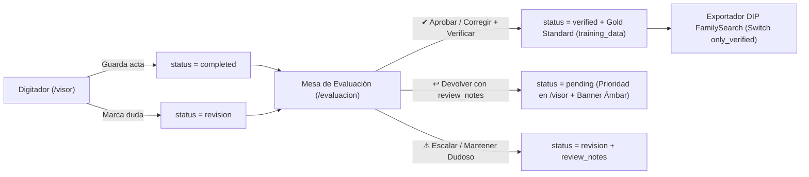

# Plan de Implementación: SPEC-017 — Rol de Evaluador (`evaluator`) y Mesa de Arbitraje de Calidad (`/evaluacion`)

## 1. Resumen Arquitectónico

Esta especificación introduce la etapa formal de **Control de Calidad y Arbitraje Archivístico** en CodexFlow mediante el nuevo rol **`evaluator`** (*Evaluador de Calidad*) y la nueva vista dedicada **`/[subdomain]/evaluacion`** (*Mesa de Arbitraje de Calidad*), accesible para `evaluator`, `admin`, `archivist` y `superadmin`.

La arquitectura se diseña bajo una estrategia **híbrida resiliente (Columnas SQL + Fallback JSONB en `metadata`)**, garantizando que toda la trazabilidad de auditoría (`digitized_by`, `verified_by`, `verified_at`, `review_notes`, `priority_returned`, `evaluation_locked_at`, `evaluation_locked_by`) funcione inmediatamente en producción sin bloquear la aplicación si la migración SQL aún no ha sido ejecutada manualmente en Supabase.



---

## 2. Diseño de Base de Datos (`supabase/migrations/017_evaluator_role_and_arbitration.sql`)

### 2.1 Extensión de Tipos y Restricciones de Rol (`user_profiles`)
- Si existe un tipo `user_role` o constraint `CHECK` sobre `user_profiles.role`, ampliarlo para admitir `'evaluator'` junto con `'superadmin'`, `'admin'`, `'archivist'`, `'digitizer'`, `'pending'` y `'rejected'`.
- Si existe el enum `folio_status` en PostgreSQL:
  ```sql
  ALTER TYPE folio_status ADD VALUE IF NOT EXISTS 'verified';
  ```

### 2.2 Columnas y Metadatos de Auditoría en `folios` y `folio_entries`
- Añadir columnas opcionales en `folios` y `folio_entries` (`ADD COLUMN IF NOT EXISTS`):
  - `digitized_by TEXT` — Email o nombre del operador que transcribió el acta.
  - `verified_by TEXT` — Email o nombre del Evaluador que certificó el acta.
  - `verified_at TIMESTAMPTZ` — Fecha/hora exacta de verificación.
  - `review_notes TEXT` — Observación o motivo de rechazo redactado por el Evaluador.
  - `evaluation_locked_at TIMESTAMPTZ` — Marca temporal del bloqueo concurrente de 15 minutos en la Mesa de Evaluación.
  - `evaluation_locked_by UUID` — ID del Evaluador que mantiene el bloqueo activo.
- **Resiliencia JSONB (`metadata`)**: El backend leerá y escribirá estos mismos atributos dentro del campo `metadata` JSONB de `folios` (y en el objeto `data` / `metadata` de `folio_entries` si las columnas físicas no existen aún), asegurando compatibilidad 100% libre de errores de esquema.

---

## 3. Diseño de Backend (`backend/main.py` y `backend/exporters/familysearch.py`)

### 3.1 Soporte RBAC para el Rol `evaluator`
1. **Invitación y Gestión de Equipo**:
   - Actualizar `VALID_ROLES` / validaciones en `POST /api/users/invite`, `POST /api/v1/team/invite` y `PATCH /api/v1/team/{user_id}/role` para permitir el rol `"evaluator"`.
2. **Permisos de Lectura y Operación**:
   - Permitir al rol `"evaluator"` consultar `/api/v1/records`, `/api/v1/folios/...`, `/api/v1/folders/...`, `/api/v1/templates/...` y operar todos los endpoints de `/api/v1/evaluation/...`.
   - Mantener restringidos para `"evaluator"` los endpoints destructivos o de administración de usuarios/ingesta (`/api/v1/team/...`, creación/borrado de lotes o plantillas).

### 3.2 Nuevos Endpoints de Mesa de Evaluación (`/api/v1/evaluation/...`)

#### A. `GET /api/v1/evaluation/queue`
- **Acceso**: `evaluator`, `admin`, `archivist`, `superadmin`.
- **Query Params**:
  - `queue_type`: `"to_verify"` (filtra `status == "completed"`), `"doubtful"` (filtra `status == "revision"`), o `"all"` (`status in ("completed", "revision")`).
  - `series`: `Optional[str]` (ej. `"Bautizos"`, `"Matrimonios"`, `"Defunciones"`).
  - `folder_id`: `Optional[str]` (Tomo / Libro específico).
  - `page`: `int = 1`, `page_size`: `int = 25`.
- **Respuesta**:
  - `items`: Lista enriquecida de folios pendientes de evaluación (con código de tomo, serie, número de partidas, `digitized_by`, `updated_at`, `review_notes`, y estado de bloqueo).
  - `counts`: `{ to_verify: int, doubtful: int, verified_today: int, total_verified: int }`.
  - `total`, `page`, `page_size`.

#### B. `POST /api/v1/evaluation/get_next`
- **Acceso**: `evaluator`, `admin`, `archivist`, `superadmin`.
- **Payload / Params**: `queue_type: str = "to_verify"`, `folder_id: Optional[str] = None`, `series: Optional[str] = None`, `specific_folio_id: Optional[str] = None`.
- **Lógica de Bloqueo Concurrente (15 Minutos)**:
  - Si se solicita `specific_folio_id` (desde la Lista de Selección) o el siguiente disponible en la Cola Continua:
  - Filtra folios del `tenant_id` con `status == "completed"` (para `to_verify`) o `status == "revision"` (para `doubtful`).
  - Descarta folios cuyo `evaluation_locked_at` (en columna o `metadata.evaluation_locked_at`) sea menor a 15 minutos atrás y pertenezca a otro usuario (`evaluation_locked_by != current_user.id`).
  - Sella el bloqueo para el evaluador actual (`evaluation_locked_at = now_iso`, `evaluation_locked_by = current_user.id`) en `metadata` (y columna si aplica).
  - Devuelve el payload completo listo para la Mesa Dual: `folio`, `view_url` (Presigned URL de Cloudflare R2), `template` (con su `schema` de campos), `entries` (`folio_entries` ordenadas por `entry_number`), `inherited_context` (`folder_code`, ` folder_name`, `series`, `location`) y metadatos de trazabilidad (`digitized_by`, `digitized_at`, `review_notes`, `verified_by`, `verified_at`).

#### C. `POST /api/v1/evaluation/{folio_id}/verdict`
- **Acceso**: `evaluator`, `admin`, `archivist`, `superadmin`.
- **Payload (`EvaluationVerdictRequest`)**:
  ```python
  class EvaluationVerdictRequest(BaseModel):
      verdict: str  # "verify_entry" | "verify_all" | "return_to_digitizer" | "mark_doubtful"
      entry_id: Optional[str] = None
      entry_number: Optional[int] = None
      entries: Optional[List[FolioEntryCreate]] = None
      review_notes: Optional[str] = None
  ```
- **Comportamiento Detallado**:
  1. **Detección de Correcciones y Active Learning (*Gold Standard*)**:
     - Si el Evaluador envía `entries` con modificaciones respecto a los valores guardados previamente por el digitador y el veredicto es de verificación (`verify_entry` o `verify_all`), por cada campo modificado se inserta un registro en `training_data` con:
       - `action_type = "evaluator_verified_correction"`
       - `original_text` (valor del digitador) y `corrected_text` (valor verificado por el evaluador).
     - Se actualizan los datos de `folio_entries` con las correcciones del Evaluador.
  2. **Aplicación del Veredicto**:
     - **`verify_entry`**: Marca la partida indicada (`entry_id` / `entry_number`) como `status = "verified"`, registrando `verified_by` y `verified_at = now_iso`. Si con ello **todas** las partidas del folio quedan en `"verified"`, promueve automáticamente el `folio` padre a `status = "verified"` y libera el bloqueo (`evaluation_locked_at = None`).
     - **`verify_all`**: Marca todas las partidas del folio y el `folio` padre como `status = "verified"`, sella `verified_by` y `verified_at = now_iso`, limpia `priority_returned = False` y libera el bloqueo.
     - **`return_to_digitizer`**: Cambia el `folio` padre (y la partida correspondiente) a `status = "pending"`, guarda `review_notes` en `metadata.review_notes`, establece `metadata.priority_returned = True`, `metadata.returned_by = evaluator_identifier`, `metadata.returned_at = now_iso`, y libera el bloqueo de evaluación.
     - **`mark_doubtful`**: Cambia o mantiene el `folio` y la partida en `status = "revision"`, guarda `review_notes` en `metadata.review_notes`, `metadata.reviewed_by = evaluator_identifier`, `metadata.reviewed_at = now_iso`, y libera el bloqueo de evaluación.

### 3.3 Trazabilidad `digitized_by` y Prioridad en Cola de Digitación (`/visor`)
1. **Registro de `digitized_by`**:
   - En `POST /api/v1/folios/{folio_id}/entries` y `POST /api/v1/folios/{folio_id}/submit`: registrar en `metadata` del folio `digitized_by` (nombre completo o email del operador actual) y `digitized_at = now_iso`. Si el folio tenía `priority_returned = True` y el digitador lo completa, limpiar `priority_returned = False`.
2. **Prioridad en `POST /api/v1/folios/get_next`**:
   - Antes de invocar el RPC estándar `get_next_folio`, consultar si existen folios del `tenant_id` (y `folder_id` si fue filtrado) en `status == "pending"` cuyo `metadata->>'priority_returned'` sea `'true'` (o tengan `review_notes` pendiente de subsanar) y no estén bloqueados por otro digitador en los últimos 15 minutos.
   - Si existe alguno, bloquearlo y entregárselo inmediatamente al digitador como máxima prioridad, incluyendo `review_notes` en la respuesta.

### 3.4 Switch `only_verified` en Exportación DIP FamilySearch
- En `GET /api/v1/folders/{folder_id}/pre-export-summary` y `GET /api/v1/folders/{folder_id}/export-familysearch`:
  - Añadir el parámetro `only_verified: bool = Query(False)`.
  - Si `only_verified == True`, filtrar folios/partidas únicamente con `status == "verified"`.
  - Si `only_verified == False` (por defecto), incluir `status in ("completed", "verified")`.
  - En `pre-export-summary`, devolver también el desglose `{ completed_count, verified_count }` para que el modal informe con precisión cuántas actas están 100% verificadas por un Evaluador.

---

## 4. Diseño de Frontend (`frontend/src/`)

### 4.1 Navegación RBAC, Layout y Redirección Post-Login
1. **[Sidebar.tsx](file:///c:/Users/CARITAS%20CARUPANO/Desktop/CodexFlow/frontend/src/components/Sidebar.tsx)**:
   - Incorporar el ítem **`Mesa de Evaluación`** (`href: '/[subdomain]/evaluacion'`, icono `ShieldCheck`).
   - Matriz de visibilidad en Sidebar:
     - `digitizer`: Dashboard, Visor de Indexación, Registros.
     - `evaluator`: Dashboard, **Mesa de Evaluación**, Visor de Indexación, Registros (oculta *Ingesta y Plantillas* y *Equipo*).
     - `archivist`, `admin`, `superadmin`: Todos los módulos incluyendo **Mesa de Evaluación**.
   - Añadir badge/etiqueta de rol para `evaluator`: `"Evaluador de Calidad"`.
2. **[login/page.tsx](file:///c:/Users/CARITAS%20CARUPANO/Desktop/CodexFlow/frontend/src/app/login/page.tsx) y [[subdomain]/layout.tsx](file:///c:/Users/CARITAS%20CARUPANO/Desktop/CodexFlow/frontend/src/app/%5Bsubdomain%5D/layout.tsx)**:
   - En `login/page.tsx`: si el rol del usuario autenticado es `"evaluator"`, redirigir automáticamente a `/[subdomain]/evaluacion`.
   - En `[subdomain]/layout.tsx`: proteger las rutas `/ingest` y `/settings/users` para que si un `"evaluator"` intenta acceder por URL directa, sea redirigido a `/[subdomain]/evaluacion`.

### 4.2 Gestión de Equipo (`frontend/src/app/[subdomain]/settings/users/page.tsx`)
- Añadir el rol **`Evaluador de Calidad (`evaluator`)`** tanto en el `<select>` del modal de invitación (`Invitar Miembro`) como en el selector de cambio de rol en cada fila de la tabla de usuarios.
- Añadir el badge visual distintivo para `evaluator` (color esmeralda/teal con icono de verificación).

### 4.3 Nueva Vista: Mesa de Arbitraje de Calidad (`frontend/src/app/[subdomain]/evaluacion/page.tsx`)
Diseñada con estética **Stitch Dark Carbon (`#121214`) + acentos Terracota (`#d2691e`) y Esmeralda (`#10b981`)**:

1. **Barra Superior de Arbitraje (Header)**:
   - **KPIs en Vivo**: Contadores de *Por Verificar (`completed`)*, *Dudosos (`revision`)* y *Verificados*.
   - **Selector de Pestaña de Cola**:
     - `[ 📋 Por Verificar (Completados) ]`
     - `[ ⚠️ Dudosos / Ilegibles (En Revisión) ]`
   - **Selector de Modo de Trabajo**:
     - `[ ⚡ Mesa Dual (Cola Continua) ]`
     - `[ 🗂️ Lista de Selección por Tomo ]`
   - **Filtros Rápidos**: Selector de `Serie Documental` y `Tomo / Libro`.

2. **Modo Lista de Selección**:
   - Tabla paginada con los folios de la cola activa mostrando: Código de Folio, Tomo/Serie, N° de Partidas, Digitador responsable (`digitized_by`), Fecha, Observaciones previas (`review_notes`) y botón **`[ Evaluar Ahora ]`** que abre el folio directamente en el Modo Mesa Dual.

3. **Modo Mesa Dual de Evaluación (Split-Screen)**:
   - **Panel Izquierdo (Visor Paleográfico de Alta Resolución)**:
     - Imagen del manuscrito con controles completos de Zoom (`+`/`-`), Pan, Rotación, **Lupa Interactiva (`[L]`)** con nivel de aumento configurable y **Filtros de Legibilidad** (`FilterControlsPopover`: brillo, contraste, inversión, escala de grises).
   - **Panel Derecho (Formulario de Auditoría y Veredicto)**:
     - **Tarjeta de Trazabilidad del Operador**: Muestra claramente `Digitado por: [Nombre/Email]`, `Tomo / Serie`, `Localidad heredada`, estado actual del folio y si registra alguna nota de revisión previa.
     - **Barra de Pestañas Multi-Partida**: Pestañas `[Partida 1]`, `[Partida 2]`, etc., con indicador visual de estado por partida (`completed`, `verified`, `revision`) y botón de acción rápida **`[ ✔ Verificar Todas las Partidas del Folio ]`**.
     - **Formulario Editable ("Corregir y Verificar")**: Renderiza todos los campos del esquema de la plantilla con los valores transcritos por el digitador. Si el Evaluador edita algún campo, se resalta sutilmente indicando que se guardará como corrección *Gold Standard* al verificar.
     - **Caja de Observaciones (`review_notes`)**: Textarea para redactar instrucciones claras al digitador (obligatoria o sugerida al pulsar *Devolver* o *Dudoso*).
     - **Barra Inferior de 3 Botones de Veredicto + Atajos de Teclado**:
       1. **`[ ✔ Aprobar y Verificar (Ctrl+Enter) ]`** — Sella `verified` (guardando correcciones si las hubo) y carga automáticamente el siguiente folio de la cola.
       2. **`[ ↩ Devolver al Digitador (Alt+R) ]`** — Devuelve a `pending` con máxima prioridad (`priority_returned = true`) y `review_notes`, y avanza al siguiente folio.
       3. **`[ ⚠ Escalar / Mantener Dudoso ]`** — Marca en `revision` con `review_notes` y avanza al siguiente folio.

### 4.4 Banner de Observación del Evaluador en el Visor (`frontend/src/app/[subdomain]/visor/page.tsx`)
- Cuando el folio activo en `/visor` posea `review_notes` (en `folio.metadata?.review_notes` o en la partida activa), renderizar en la parte superior del panel derecho un **Banner de Alerta Ámbar/Rojo**:
  - Icono `AlertTriangle`, título `"Observación del Evaluador de Calidad"` (mostrando `returned_by` si está disponible) y el texto íntegro de `review_notes` para que el digitador corrija exactamente lo indicado.

### 4.5 Switch `only_verified` en Exportación DIP (`frontend/src/components/ExportFamilySearchModal.tsx`)
- En el modal de exportación FamilySearch DIP:
  - Mostrar en el resumen previo cuántas actas están en estado `Verificadas por Evaluador (verified)` frente a `Completadas (completed)`.
  - Incorporar un switch/checkbox interactivo:
    **`"Exportar exclusivamente actas Verificadas por Evaluador (100% auditadas)"`**.
  - Al activarlo, pasar `&only_verified=true` tanto al endpoint de resumen como a la descarga del archivo `.ZIP`.

---

## 5. Plan de Verificación y Criterios de Aceptación
1. **Compilación Limpia**: `python -m py_compile backend/main.py backend/exporters/familysearch.py` y `npm run build` en `frontend/` sin errores de tipos ni lint.
2. **RBAC del Evaluador**: Un usuario con rol `evaluator` es redirigido a `/[subdomain]/evaluacion` tras iniciar sesión, ve *Mesa de Evaluación*, *Visor* y *Registros*, y no puede acceder a `/ingest` ni `/settings/users`.
3. **Ciclo Completo de Arbitraje**:
   - Verificar un acta (`Ctrl+Enter`) cambia su estado a `verified`, registra `verified_by` / `verified_at` y, si hubo edición de campos, inserta la corrección en `training_data` (`evaluator_verified_correction`).
   - Devolver un acta (`Alt+R`) con `review_notes` la pasa a `pending` con `priority_returned = true`, apareciendo primera en `/visor` con el banner ámbar de observación.
4. **Exportación DIP**: El switch `only_verified` en `ExportFamilySearchModal.tsx` filtra correctamente el paquete `.ZIP` para incluir solo actas `verified` cuando está activo.
