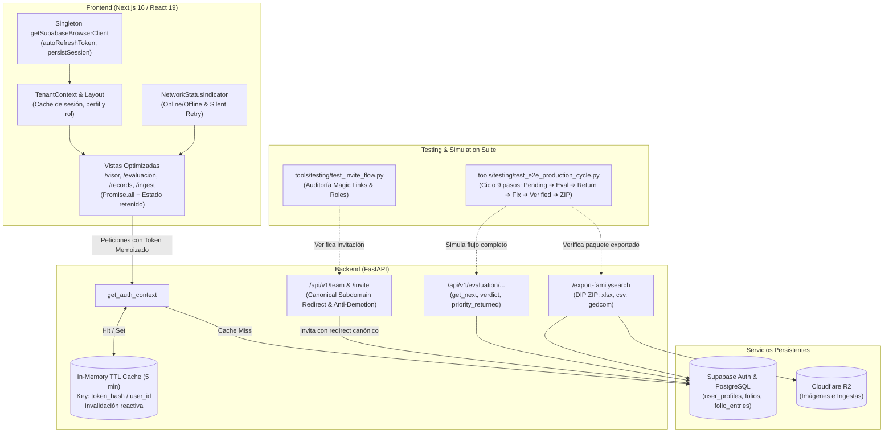

# PLAN-018: Blindaje Integral de Estabilidad, Auditoría de Invitaciones, Simulación E2E y Fluidez de Vistas

## 1. Resumen Ejecutivo y Metas Arquitectónicas

El objetivo de esta especificación técnica es consolidar y blindar el ecosistema de producción de **CodexFlow**. Tras la culminación exitosa de los módulos funcionales clave (Mesa de Arbitraje de Calidad SPEC-017, Paquetes de Exportación FamilySearch SPEC-016 y Modelado Jerárquico SPEC-012/013), se requiere erradicar cuellos de botella de red, evitar re-renders innecesarios, garantizar la continuidad de sesiones de digitadores, sanitizar el árbol de rutas y certificar el ciclo de vida completo mediante pruebas automatizadas E2E.

Este plan técnico formaliza la ejecución de los **3 frentes estratégicos** validados en el Triple Filtro QA (15 respuestas consensuadas):
1. **Frente 1: Resiliencia de Sesiones, Invitaciones Canónicas y Blindaje RBAC**.
2. **Frente 2: Fluidez y Rendimiento Extremo de Vistas (Cero Retrasos)**.
3. **Frente 3: Simulación E2E del Ciclo Completo y Blindaje ante Desconexión**.

---

## 2. Diagrama de Arquitectura y Flujo Integral



---

## 3. Desglose Técnico por Frente

### Frente 1: Resiliencia de Sesiones, Invitaciones Canónicas y Blindaje RBAC

#### 1.1 Singleton `getSupabaseBrowserClient` en Frontend
- **Ubicación**: `frontend/src/lib/supabaseClient.ts`
- **Problema actual**: Cada página (`/visor`, `/records`, `/evaluacion`, `/ingest`, `/settings/users`) y el archivo `layout.tsx` instancian repetidamente `createBrowserClient` dentro de hooks o funciones de render. Esto genera múltiples instancias del cliente HTTP, conexiones WebSocket duplicadas para listeners de sesión y fugas de memoria.
- **Solución técnica**:
  - Implementar un patrón singleton memoizado:
    ```typescript
    let browserClient: SupabaseClient | null = null;
    export function getSupabaseBrowserClient(): SupabaseClient {
      if (!browserClient) {
        browserClient = createBrowserClient(
          process.env.NEXT_PUBLIC_SUPABASE_URL!,
          process.env.NEXT_PUBLIC_SUPABASE_ANON_KEY!,
          {
            auth: {
              persistSession: true,
              autoRefreshToken: true,
              detectSessionInUrl: true,
            }
          }
        );
      }
      return browserClient;
    }
    ```
  - Reemplazar todas las invocaciones directas a `createBrowserClient` en las vistas por `getSupabaseBrowserClient()`.

#### 1.2 Contexto Compartido de Tenant en `layout.tsx`
- **Ubicación**: `frontend/src/app/[subdomain]/layout.tsx` y nuevo contexto `frontend/src/context/TenantContext.tsx`
- **Problema actual**: El `useEffect` en `layout.tsx` tiene dependencia `[pathname, subdomain, router]`. Cada vez que el usuario hace clic en el Sidebar para cambiar de ruta interna, `layout.tsx` activa `setLoading(true)` y vuelve a llamar a `supabase.auth.getSession()` y `fetch('/api/auth/me')`, causando parpadeos de carga ("Verificando accesos...") y latencia innecesaria.
- **Solución técnica**:
  - Crear un proveedor `TenantContext` que almacene `{ session, user, role, tenantId, subdomain, loading }`.
  - La verificación de sesión se ejecuta **una sola vez** al montar la sesión en el subdominio o tras eventos explícitos `onAuthStateChange`.
  - La navegación entre subrutas (`/visor`, `/records`, `/evaluacion`, `/ingest`) solo ejecuta la regla de control de acceso síncrona en memoria basada en el `role` ya cacheado:
    - **Digitador (`digitizer`)**: Solo autorizado en `/{subdomain}/visor` y `/{subdomain}/metrics`. Si intenta acceder a `/ingest`, `/evaluacion` o `/settings/users`, se redirige inmediatamente a `/{subdomain}/visor` desplegando un toast informativo: *"Acceso restringido a tu rol"*.
    - **Evaluador (`evaluator`)**: Solo bloqueado en `/ingest` y `/settings/users`, redirigiendo a `/{subdomain}/evaluacion`.
  - Los hijos heredan el contexto mediante el hook `useTenant()`, eliminando peticiones de rol redundantes en páginas hijas.

#### 1.3 Invitaciones Canónicas y Protección Anti-Auto-Eliminación
- **Ubicación**: `backend/main.py` y `frontend/src/app/[subdomain]/settings/users/page.tsx`
- **Problema actual**: El endpoint de invitación hardcodea `https://codexflow-frontend.vercel.app/welcome` sin considerar el subdominio del tenant. El usuario invitado cae en una ruta genérica y pierde el contexto organizacional. Además, en frontend no existe validación preventiva para evitar degradar o auto-eliminar al único administrador activo.
- **Solución técnica**:
  - **Backend (`/api/v1/team/invite`)**:
    - Obtener el subdominio del tenant desde `auth["tenant_id"]` (o parámetro opcional).
    - Construir la URL de redirección canónica:
      `redirect_to = f"{BASE_URL}/{tenant_subdomain}/login"` (o `/welcome` con query param `subdomain`).
    - Validar que el rol asignado sea uno de los roles permitidos (`admin`, `archivist`, `evaluator`, `digitizer`).
  - **Backend (`/api/v1/team/{target_user_id}`)**:
    - Reforzar la verificación existente: impedir que el último administrador activo sea degradado de rol o marcado como `is_active = False`.
  - **Frontend (`/settings/users/page.tsx`)**:
    - Usar `getSupabaseBrowserClient()`.
    - Detectar si la fila corresponde al usuario actual (`user.id === target_user_id`): deshabilitar selectores de rol y botones de desactivación con tooltip *"No puedes modificar tu propia cuenta"*.
    - Si solo hay 1 usuario con rol `admin` activo, deshabilitar la degradación de dicho usuario con alerta preventiva.

#### 1.4 Suite de Prueba de Integración de Invitaciones
- **Ubicación**: `tools/testing/test_invite_flow.py`
- **Solución técnica**:
  - Script independiente en Python que:
    1. Se autentica como administrador del tenant de prueba.
    2. Ejecuta `POST /api/v1/team/invite` con un correo de prueba temporal.
    3. Verifica que la respuesta sea HTTP 200 y contenga la confirmación.
    4. Comprueba en Supabase (`user_profiles`) que el registro tenga el `tenant_id` y `role` correspondientes.
    5. Intenta degradar al último admin y certifica que el backend devuelva HTTP 400.
    6. Limpia los datos de prueba creados.

---

### Frente 2: Fluidez y Rendimiento Extremo de Vistas (Cero Retrasos)

#### 2.1 Caché en Memoria TTL (5 minutos) en Backend para `get_auth_context`
- **Ubicación**: `backend/main.py`
- **Problema actual**: `get_auth_context` realiza dos viajes de red a Supabase Cloud por **cada** petición HTTP:
  1. `supabase.auth.get_user(token)`
  2. `supabase.table("user_profiles").select(...).eq("user_id", user_id).execute()`
  Esto agrega 150-400ms de latencia por endpoint.
- **Solución técnica**:
  - Implementar una estructura de caché en memoria con TTL de 300 segundos:
    ```python
    _AUTH_CACHE: Dict[str, Tuple[datetime, Dict[str, Any]]] = {}
    AUTH_CACHE_TTL_SECONDS = 300
    ```
  - Clave de caché basada en hash SHA-256 del token Bearer recibido.
  - Al recibir una petición:
    - Si el token está en caché y `now < expires_at`: retornar la estructura cacheada `{tenant_id, user_client, user_id, role}` inmediatamente (0ms latencia de BD).
    - Si expiró o no existe: consultar Supabase, instanciar `user_client`, almacenar en caché y retornar.
  - **Invalidación Reactiva**:
    - Función auxiliar `invalidate_auth_cache_for_user(user_id: str)` que purgue entradas correspondientes al usuario modificado.
    - Se invoca en `PATCH /api/v1/team/{target_user_id}` para asegurar que cambios de rol o desactivaciones tengan efecto inmediato sin esperar 5 minutos.

#### 2.2 Migración de Vistas a Singleton y Peticiones Concurrentes (`Promise.all`)
- **Vistas**: `ingest/page.tsx`, `records/page.tsx`, `visor/page.tsx`, `evaluacion/page.tsx`
- **Solución técnica**:
  - Cambiar `createBrowserClient` por `getSupabaseBrowserClient()`.
  - Agrupar peticiones iniciales independientes con `Promise.all`:
    - En `records/page.tsx`: Cargar lotes, carpetas y conteos de estado en paralelo al montar.
    - En `ingest/page.tsx`: Cargar árbol de carpetas, plantillas y lotes en paralelo.
    - En `evaluacion/page.tsx`: Cargar conteos de colas y lista de carpetas en paralelo.
  - **Retención de Estado al Navegar**:
    - Guardar en estado de memoria o `sessionStorage` los filtros activos de `/records` (página, término de búsqueda, serie seleccionada) para que al volver desde `/visor` no se reinicie la consulta ni se muestren pantallas vacías.

#### 2.3 Purgado de Rutas Huérfanas y Código Muerto
- **Rutas a purgar**:
  - `frontend/src/app/[subdomain]/dudosos/`: Ruta obsoleta no referenciada que contenía mocks de desarrollo. Las dudas y revisiones son gestionadas centralizadamente en `/evaluacion` y `/ingest`.
  - `frontend/src/app/[subdomain]/visor/[batch_id]/`: Ruta residual que usaba OpenSeadragon con mocks obsoletos; todo el flujo canónico opera bajo `/[subdomain]/visor`.
- **Acciones**:
  - Eliminar los directorios completos.
  - Verificar que ningún archivo del proyecto contenga enlaces residuales a estas rutas.

---

### Frente 3: Simulación E2E del Ciclo Completo y Blindaje ante Desconexión

#### 3.1 Indicador Visual de Conectividad y Resiliencia Offline
- **Ubicación**: `frontend/src/components/NetworkStatusIndicator.tsx` montado en la barra superior o en `layout.tsx`.
- **Solución técnica**:
  - Escuchar eventos nativos `window.addEventListener('online')` y `window.addEventListener('offline')`.
  - Estado visual:
    - **Online**: Indicador verde discreto ("Conectado").
    - **Offline**: Indicador ámbar/rojo parpadeante ("Sin conexión - Guardando localmente").
  - Al detectar desconexión, asegurar que los borradores de transcripción en `/visor` queden resguardados en `LocalStorage` (a través del hook existente `useLocalAutosave`).
  - Al recuperar conexión: reintento silencioso con *exponential backoff* (reintento cada 5 segundos) para sincronizar cambios pendientes con la API de FastAPI.

#### 3.2 Suite de Simulación Automatizada E2E del Ciclo Completo
- **Ubicación**: `tools/testing/test_e2e_production_cycle.py`
- **Flujo de Ejecución (9 Pasos Rigurosos)**:
  1. **Selección de Folio de Prueba**:
     - Localizar un folio existente en estado `pending` en el tenant de pruebas (ej. Folio de Bautismo).
  2. **Simulación de Digitación (Rol: Digitador)**:
     - Realizar `POST /api/v1/folios/{folio_id}/entries` con payload de partidas válidas y marcar estado `completed`.
     - Validar HTTP 200 y persistencia de partidas en base de datos.
  3. **Toma en Mesa de Evaluación (Rol: Evaluador)**:
     - Realizar `POST /api/v1/evaluation/get_next` solicitando el folio específico.
     - Validar que el folio devuelva `status == 'completed'`, con bloqueo temporal de evaluación (`evaluation_locked_by`).
  4. **Devolución al Digitador (`return_to_digitizer`)**:
     - Realizar `POST /api/v1/evaluation/{folio_id}/verdict` con `verdict = "return_to_digitizer"` y notas de revisión `review_notes = "Corregir fecha de bautismo"`.
     - Validar que el folio cambie a `status = 'pending'`, `priority_returned = True` y desbloquee el lock.
  5. **Verificación de Prioridad en Cola de Digitación**:
     - Simular llamada a `get_next_folio` del digitador y verificar que el folio devuelto aparezca de primero por tener `priority_returned == True`.
  6. **Corrección y Re-envío por el Digitador**:
     - Guardar la corrección en `POST /api/v1/folios/{folio_id}/entries` y volver a enviar con `status = 'completed'`.
  7. **Arbitraje y Aprobación Final por Evaluador**:
     - Realizar `POST /api/v1/evaluation/{folio_id}/verdict` con `verdict = "verify_all"`.
     - Validar que el folio y sus partidas pasen a `status = 'verified'` con `verified_by` y `verified_at` poblados.
  8. **Exportación y Verificación del Paquete DIP FamilySearch**:
     - Solicitar `GET /api/v1/folders/{folder_id}/export-familysearch?only_verified=true`.
     - Validar respuesta HTTP 200 con `Content-Type: application/zip`.
     - Descomprimir el `.ZIP` en memoria y verificar que existan:
       - `manifest.json`: metadatos de auditoría y score de calidad.
       - `matriz_indexacion.xlsx`: hoja de cálculo con filas formateadas y encabezados estándar FamilySearch.
       - `matriz_indexacion.csv`: archivo CSV codificado en UTF-8 con BOM.
       - `export_gedcom.ged`: archivo GEDCOM 5.5.1 estructurado con familias y eventos válidos.
  9. **Restauración / Teardown Controlado**:
     - Restaurar el folio de prueba a su estado original o eliminar datos sintéticos para no contaminar el entorno de producción/demostración.

---

## 4. Estrategia de Verificación y Criterios de Aceptación

| Frente | Métrica / Criterio de Éxito | Método de Validación |
|---|---|---|
| **Frente 1** | Cero reinicializaciones de cliente Supabase en cambios de vista | Auditoría de llamadas a `getSupabaseBrowserClient` |
| **Frente 1** | Invitaciones redirigen al subdominio canónico correcto | Ejecución exitosa de `tools/testing/test_invite_flow.py` |
| **Frente 1** | Imposible auto-eliminar o degradar al último admin | Test unitario de endpoint `PATCH /api/v1/team/{id}` |
| **Frente 2** | Reducción del 90% en consultas a Supabase Auth en backend | Caché TTL 5 min en `get_auth_context` con tests |
| **Frente 2** | Rutas huérfanas `/dudosos` y `/visor/[batch_id]` eliminadas | Verificación de sistema de archivos sin rotura de imports |
| **Frente 2** | Vistas montan datos iniciales en paralelo sin pantallas en blanco | Inspección de `Promise.all` y retención de filtros |
| **Frente 3** | Indicador de red reporta online/offline y activa reintentos | Inspección de eventos y componente `NetworkStatusIndicator` |
| **Frente 3** | Ciclo de vida completo verificado de punta a punta (9 pasos) | Ejecución sin fallos de `test_e2e_production_cycle.py` |
