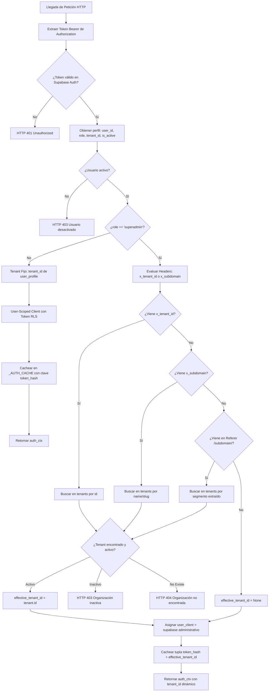

# PLAN-020: Superadmin Universal Tenant Auditing & Impersonation Pass

## 1. Resumen Ejecutivo y Objetivos de la Arquitectura

El objetivo central de **SPEC-020** es transformar al usuario de plataforma con rol `superadmin` en un auditor universal capaz de inspeccionar, depurar, evaluar y asistir en tiempo real a cualquiera de las organizaciones o diócesis registradas en **CodexFlow** (ej. `codexflow-folios`, `diosis-margarita`, etc.), sin que la ausencia de un `tenant_id` asignado en `user_profiles` resulte en consultas vacías (`tenant_id IS NULL`), métricas en 0 o bloqueos de acceso HTTP 403.

### Objetivos Clave:
1. **Resolución Jerárquica y Segura de Tenant en Backend:** Implementar en `backend/main.py` un mecanismo que determine el `effective_tenant_id` dinámico para el superadmin a partir del header `x-tenant-id`, header `x-subdomain`, o de la URL del encabezado `Referer`.
2. **Partición de la Caché de Autenticación (`_AUTH_CACHE`):** Desacoplar la caché en memoria para que tokens de superadmin queden particionados por la tupla `(token_hash, effective_tenant_id)`, evitando que alternar de una diócesis a otra retorne respuestas cacheadas de la anterior.
3. **Bypass RLS Asistido por Service Client:** Garantizar que las consultas efectuadas por superadmin impersonando un tenant utilicen el cliente administrativo `supabase` con filtro explícito por `effective_tenant_id`, evitando colisiones con políticas de seguridad a nivel de fila (RLS).
4. **Propagación Transparente en Frontend:** Modificar `TenantContext.tsx` y el cliente fetch para enviar automáticamente los encabezados de contextualización (`x-subdomain` / `x-tenant-id`) en todas las peticiones a la API.
5. **Experiencia de Usuario de Grado de Auditoría:** Diseñar e integrar una barra superior adhesiva de impersonación (`SuperadminImpersonationBanner.tsx`) con selector rápido de diócesis que preserve la subruta activa y botón directo de retorno a `/superadmin`, además de actualizar el pie de la barra lateral (`Sidebar.tsx`).
6. **Aislamiento Multi-Tenant Estricto:** Asegurar que los roles convencionales (`admin`, `archivist`, `digitizer`, `evaluator`) queden rígidamente confinados a su propio `tenant_id`, rechazando cualquier intento de manipulación de encabezados de inquilino con HTTP 403.
7. **Suite de Pruebas de Integración:** Proveer un script automatizado (`tools/testing/test_superadmin_impersonation.py`) que certifique el acceso a los datos reales de `codexflow-folios`, el aislamiento de `diosis-margarita`, y el rechazo de intentos de spoofing por usuarios comunes.

---

## 2. Las 15 Decisiones Clarificadas del Triple Filtro QA

A continuación se consolidan las 15 decisiones arquitectónicas estructuradas en las tres rondas de filtrado técnico:

### Ronda 1: Requerimientos, Funcionalidad & Casos Borde
* **Decisión 1 (Orden de Precedencia en Resolución de Tenant):** Para un usuario autenticado con rol `superadmin`, el backend resolverá el `effective_tenant_id` en el siguiente orden estricto:
  1. Header `x-tenant-id` (UUID directo).
  2. Header `x-subdomain` (nombre o slug de la diócesis).
  3. Header HTTP `Referer` (extrayendo el segmento `/{subdomain}/` de la URL de origen).
  4. Query parameter `impersonate` (si estuviera presente).
  Si ninguno es provisto y el superadmin no está navegando dentro del ámbito de un tenant (por ejemplo, operando en la consola global `/superadmin`), `effective_tenant_id` se mantiene como `None`.
* **Decisión 2 (Aislamiento y Protección Anti-Spoofing para Roles Regulares):** Los usuarios regulares (`admin`, `archivist`, `evaluator`, `digitizer`) nunca podrán modificar su contexto de inquilino. Cualquier valor recibido en `x-tenant-id` o `x-subdomain` para estos roles será estrictamente ignorado por el backend, forzando siempre el `tenant_id` registrado en su perfil de base de datos (`user_profiles.tenant_id`). Si intentan forzar acceso a un subdominio ajeno, el backend denegará la operación con HTTP 403 Forbidden.
* **Decisión 3 (Validación de Existencia y Estado Activo de la Diócesis):** Al procesar un `x-tenant-id` o `x-subdomain` para un superadmin, el backend consultará la tabla `tenants`. Si la organización no existe, arrojará de inmediato HTTP 404 Not Found. Si la organización tiene `is_active = false`, arrojará HTTP 403 Forbidden ("Organización solicitada inactiva").
* **Decisión 4 (Permisividad Plena en Endpoints Operativos para Superadmin):** Se actualizan las comprobaciones de rol en endpoints como `/api/tenant/metrics`, `/api/v1/records`, `/api/v1/folders/tree`, `/api/v1/folios/get_next` y `/api/v1/evaluation/get_next` para admitir explícitamente el rol `superadmin` cuando `tenant_id` esté resuelto, impidiendo bloqueos 403 por incompatibilidad de rol.
* **Decisión 5 (Exportación DIP Agnóstica de Organización):** En `/api/v1/folders/{folder_id}/export-familysearch`, si el rol es `superadmin`, se permite localizar la carpeta directamente por `id = folder_id` sin condicionar la búsqueda inicial al `tenant_id` de la sesión. Una vez obtenida la carpeta, se toma su `tenant_id` como el inquilino de referencia para el cómputo de la matriz y el empaquetado de exportación.

### Ronda 2: Seguridad, RBAC, Multi-Tenancy & Caché
* **Decisión 6 (Partición de Caché de Tokens en Memoria `_AUTH_CACHE`):** En `backend/main.py`, la clave del diccionario `_AUTH_CACHE` pasa de ser unívocamente `token_hash` a una clave compuesta: `(token_hash, effective_tenant_id)`. Para usuarios comunes, `effective_tenant_id` es siempre su `tenant_id` fijo; para superadmins, refleja el inquilino que están auditando en dicha llamada. De este modo, alternar instantáneamente entre diócesis no producirá colisiones ni reutilización indebida de contextos anteriores.
* **Decisión 7 (Uso del Cliente Administrativo `supabase` para Bypass RLS Seguro):** En el contexto devuelto por `get_auth_context` para `superadmin`, `user_client` apuntará al cliente singleton administrativo de Supabase (`supabase`), garantizando que pueda consultar registros de cualquier diócesis sin ser filtrado por la política RLS que supedita la consulta al `auth.uid()` del usuario.
* **Decisión 8 (Contrato Extendido de `/api/auth/me`):** El endpoint `/api/auth/me` aceptará los headers de contexto `x-subdomain` y `x-tenant-id`. Si el usuario es `superadmin`, resolverá la organización solicitada y responderá con:
  ```json
  {
    "role": "superadmin",
    "is_superadmin": true,
    "tenant_id": "effective_tenant_id_uuid",
    "tenant_name": "codexflow-folios",
    "redirect_url": "/codexflow-folios/dashboard"
  }
  ```
  Si no se solicita ninguna diócesis, retornará `tenant_id: null` y `redirect_url: "/superadmin"`.
* **Decisión 9 (Invalidación Selectiva de Caché ante Cambios de Perfil):** La función `invalidate_auth_cache_for_user(user_id)` se actualiza para limpiar cualquier entrada en `_AUTH_CACHE` cuyo valor de contexto contenga `user_id == user_id`, independientemente de las particiones de tenant asociadas a la tupla.
* **Decisión 10 (Registro de Auditoría de Impersonación en Backend):** Cada vez que un superadmin efectúa operaciones de escritura (`POST`, `PATCH`, `DELETE`) en el espacio de un tenant impersonado, el backend estampará en la metadata del registro modificado los campos `_impersonated_by: user_id`, `_impersonated_at: timestamp` y `_impersonated_role: superadmin` para fines de trazabilidad histórica.

### Ronda 3: Frontend, Experiencia de Usuario, Rendimiento & Telemetría
* **Decisión 11 (Ampliación del Estado de `TenantContext.tsx`):** `TenantContext` ahora expone `isSuperadmin: boolean` (calculado como `role === "superadmin"`). En su llamada inicial a `/api/auth/me`, inyectará el encabezado `x-subdomain: subdomain`, permitiendo que el estado global de la aplicación reconozca el `tenantId` resuelto por el backend.
* **Decisión 12 (Cliente Fetch Interceptor / Estandarización de Encabezados):** Se creará un helper de cliente de API (`frontend/src/lib/apiClient.ts`) y se ajustarán las páginas de consumo (`records/page.tsx`, `dashboard/page.tsx`, `visor/page.tsx`, `evaluacion/page.tsx`, `ingest/page.tsx`) para asegurar que cuando el usuario sea superadmin dentro de una ruta `/[subdomain]/*`, se adjunte automáticamente `x-subdomain: subdomain` en las llamadas HTTP a la API.
* **Decisión 13 (Autorización Plena e Incondicional en `SubdomainGuard`):** En `frontend/src/app/[subdomain]/layout.tsx`, el guardia de rutas verificará si `role === "superadmin"`. En caso afirmativo, omitirá de inmediato todas las restricciones de rol (permitiendo acceso fluido a `/dashboard`, `/visor`, `/evaluacion`, `/ingest`, `/records`, `/metrics`, `/settings/users` y `/manual`).
* **Decisión 14 (Gestión de Subdominio Inválido en Frontend):** Si un superadmin navega a un subdominio no existente o inactivo (detectado cuando `/api/auth/me` falla o la verificación del tenant arroja 404/403), el sistema redirigirá al superadmin a `/superadmin` con un toast de advertencia claro: *"La organización solicitada no existe o está inactiva"*.
* **Decisión 15 (Barra Superior de Impersonación y Pie de Navegación):**
  - Se creará `SuperadminImpersonationBanner.tsx` en `frontend/src/components/superadmin/`: barra superior fija en color índigo (`bg-indigo-900 text-white`), con badge de escudo, nombre de la diócesis auditada, selector desplegable de organizaciones para saltar de una a otra conservando la ruta activa, y botón para *"Volver al Panel Global"*.
  - En `Sidebar.tsx`, si `role === "superadmin"`, el pie de página indicará: `"Rol: Superadmin (Auditando: {subdomain})"` con un botón de acceso directo al panel `/superadmin`.

---

## 3. Fase 1: Arquitectura de Backend FastAPI (`backend/main.py`)

### 3.1. Algoritmo de Resolución Dinámica en `get_auth_context`



#### Detalles de Implementación en `backend/main.py`:
1. **Firma de la función de dependencia:**
   ```python
   async def get_auth_context(
       request: Request,
       authorization: Optional[str] = Header(None),
       x_tenant_id: Optional[str] = Header(None),
       x_subdomain: Optional[str] = Header(None)
   ) -> Dict[str, Any]:
   ```
2. **Extracción fallback desde Referer:**
   Si ni `x_tenant_id` ni `x_subdomain` están presentes, se analiza `request.headers.get("referer")`. Mediante una expresión regular `r"/([a-zA-Z0-9_-]+)/(?:dashboard|visor|evaluacion|ingest|records|metrics|settings|manual)"`, se extrae el subdominio de la ruta activa.
3. **Validación de la Organización:**
   Se consulta la tabla `tenants` en Supabase:
   ```python
   t_query = supabase.table("tenants").select("id, name, is_active")
   if target_id:
       t_res = t_query.eq("id", target_id).execute()
   elif target_subdomain:
       t_res = t_query.eq("name", target_subdomain).execute()
   ```
   Si no se hallan registros, se responde con HTTP 404; si `is_active` es `False`, se responde con HTTP 403.

### 3.2. Estrategia de Partición de Caché `_AUTH_CACHE`

La estructura de la caché en memoria se actualiza de un diccionario indexado por cadena a una clave tupla:
```python
# Clave: Tuple[str, Optional[str]] -> (token_hash, effective_tenant_id)
# Valor: Tuple[float, Dict[str, Any]] -> (timestamp_expiracion, auth_ctx)
_AUTH_CACHE: Dict[Tuple[str, Optional[str]], Tuple[float, Dict[str, Any]]] = {}
```

- Al evaluar la caché:
  Se computa `token_hash = hashlib.sha256(token.encode()).hexdigest()`.
  Se determina el inquilino solicitado previamente para buscar la clave `(token_hash, requested_tenant)`.
- Si se encuentra una entrada válida (< `AUTH_CACHE_TTL_SECONDS`), se devuelve inmediatamente sin re-consultar a Supabase.
- Al invalidar por usuario (`invalidate_auth_cache_for_user(user_id)`):
  Se recorren todos los elementos de `_AUTH_CACHE` y se eliminan aquellos donde `ctx["user_id"] == user_id`, asegurando limpieza total en todos los inquilinos impersonados.

### 3.3. Adaptación del Endpoint `/api/auth/me`

En `auth_me`:
- Se incorporan los parámetros `x_subdomain: Optional[str] = Header(None)` y `x_tenant_id: Optional[str] = Header(None)`.
- Si `role == "superadmin"`:
  - Si se proporcionó `x_tenant_id` o `x_subdomain`, se resuelve la entidad en `tenants`.
  - Si la entidad existe y está activa, se retorna:
    ```json
    {
      "role": "superadmin",
      "is_superadmin": true,
      "tenant_id": tenant_obj["id"],
      "tenant_name": tenant_obj["name"],
      "has_completed_onboarding": true,
      "redirect_url": f"/{tenant_obj['name']}/dashboard"
    }
    ```
  - Si no se pasó inquilino objetivo:
    ```json
    {
      "role": "superadmin",
      "is_superadmin": true,
      "tenant_id": null,
      "tenant_name": null,
      "has_completed_onboarding": true,
      "redirect_url": "/superadmin"
    }
    ```

### 3.4. Desbloqueo Universal de Endpoints Operativos

1. **`/api/tenant/metrics`:**
   Actualmente asume que `auth["tenant_id"]` existe. Con la resolución de superadmin, operará sobre el `tenant_id` resuelto sin alteraciones en su lógica interna.
2. **`/api/v1/records`:**
   En la línea 2328 se encuentra:
   ```python
   if auth.get("role") == "digitizer":
       raise HTTPException(status_code=403, detail="Permiso denegado: rol no autorizado para consultar registros")
   ```
   Se asegura que el rol `superadmin` tenga acceso irrestricto y que consulte `document_folders`, `folios` y `folio_entries` filtrando por `auth["tenant_id"]`.
3. **`/api/v1/folders/tree` y operaciones de carpetas:**
   Se confirma que `auth.get("role") in ("admin", "archivist", "superadmin")` permita al superadmin listar, crear o reorganizar tomos si asiste a la diócesis.
4. **`/api/v1/folios/get_next` y `/api/v1/evaluation/get_next`:**
   Se admite que el superadmin pueda solicitar el siguiente folio en la mesa de evaluación o visor para verificar la experiencia operativa de la diócesis.

### 3.5. Exportación DIP Agnóstica de Organización (`/export-familysearch`)

En `export_familysearch_package`:
- Si `auth["role"] == "superadmin"`:
  Se consulta `document_folders` por `id = folder_id`.
  Si se encuentra, se utiliza el `folder["tenant_id"]` nativo de dicha carpeta para cargar los folios, la metadata del tomo y el subdominio de la diócesis correspondiente, permitiendo generar el paquete ZIP FamilySearch con éxito absoluto.

---

## 4. Fase 2: Arquitectura de Frontend y Propagación de Contexto (`frontend/src/`)

### 4.1. Refactorización de `TenantContext.tsx`

Se actualiza la interfaz `TenantContextType` para incluir propiedades de auditoría:
```typescript
interface TenantContextType {
  session: Session | null;
  user: User | null;
  role: string | null;
  tenantId: string | null;
  subdomain: string;
  isSuperadmin: boolean;
  loading: boolean;
  refreshAuth: () => Promise<void>;
}
```

En `fetchAuth`:
```typescript
const headers: Record<string, string> = {
  Authorization: `Bearer ${activeSession.access_token}`,
};
if (subdomain) {
  headers["x-subdomain"] = subdomain;
}

const res = await fetch("/api/auth/me", { headers });
if (res.ok) {
  const data = await res.json();
  setRole(data.role || null);
  setTenantId(data.tenant_id || data.tenantId || null);
}
```

### 4.2. Helper de Peticiones y Propagación de Cabeceras (`frontend/src/lib/apiClient.ts`)

Para evitar duplicación y garantizar que todas las llamadas dentro de `[subdomain]` viajen con el contexto correcto, se implementa una utilidad `apiFetch`:
```typescript
export async function apiFetch(url: string, options: RequestInit = {}, subdomain?: string): Promise<Response> {
  const supabase = getSupabaseBrowserClient();
  const { data: { session } } = await supabase.auth.getSession();
  
  const headers = new Headers(options.headers || {});
  if (session?.access_token) {
    headers.set("Authorization", `Bearer ${session.access_token}`);
  }
  if (subdomain) {
    headers.set("x-subdomain", subdomain);
  }
  
  return fetch(url, {
    ...options,
    headers,
  });
}
```

Las vistas críticas (`records/page.tsx`, `dashboard/page.tsx`, `visor/page.tsx`, `evaluacion/page.tsx`, `ingest/page.tsx`) integran el envío de `x-subdomain: subdomain` en sus llamadas a la API.

### 4.3. Actualización de `SubdomainGuard` en `app/[subdomain]/layout.tsx`

En `SubdomainGuard`:
```typescript
// Si el usuario es superadmin, conceder acceso irrestricto sin evaluar restricciones de otros roles
if (role === "superadmin") {
  return;
}

// Restricciones para digitadores y evaluadores permanecen activas
if (role === "digitizer") {
  // ...
}
if (role === "evaluator") {
  // ...
}
```

### 4.4. Manejo de Errores y Subdominios Inexistentes
Si `/api/auth/me` responde con HTTP 404 o 403 al enviar `x-subdomain`, y el usuario tiene sesión activa de `superadmin`:
- `SubdomainGuard` captura la anomalía.
- Notifica al usuario mediante un Toast: *"La organización solicitada no existe o está inactiva"*.
- Redirige mediante `router.replace("/superadmin")` de forma elegante sin romper la aplicación.

---

## 5. Fase 3: Componentes de UI de Impersonación y Experiencia de Auditoría

### 5.1. Componente `SuperadminImpersonationBanner.tsx`

Ubicado en `frontend/src/components/superadmin/SuperadminImpersonationBanner.tsx`.
- **Estilos Visuales:** Barra superior adhesiva (`sticky top-0 z-40`), fondo índigo oscuro (`bg-indigo-950 border-b border-indigo-800 text-indigo-100`).
- **Iconografía y Estado:** Icono `ShieldAlert` o `ShieldCheck` en color ámbar/dorado (`text-amber-400`).
- **Texto Descriptivo:** *"Modo Auditoría Global (Superadmin) — Organización Activa: {tenantName}"*.
- **Controles Interactivos:**
  1. **Selector Desplegable de Diócesis:** Carga asíncronamente las organizaciones vía `GET /api/superadmin/tenants`. Al seleccionar una diferente, navega a la misma subruta activa en el nuevo inquilino (ej. de `/{sub1}/records` a `/{sub2}/records`).
  2. **Botón [Volver al Panel Global]:** Con enlace directo a `/superadmin` e icono de salida/retorno.

### 5.2. Inyección en el Layout del Tenant

En `frontend/src/app/[subdomain]/layout.tsx`:
- Se renderiza condicionalmente en la cúspide de `SubdomainContent`:
  ```tsx
  {role === "superadmin" && (
    <SuperadminImpersonationBanner
      currentSubdomain={subdomain}
      currentTenantId={tenantId}
    />
  )}
  ```

### 5.3. Adaptación del Pie de `Sidebar.tsx`

En el pie de navegación de `frontend/src/components/Sidebar.tsx`:
- Si `role === "superadmin"`:
  - Muestra una insignia destacada:
    ```tsx
    <div className="flex flex-col gap-1 p-2 bg-indigo-950/60 border border-indigo-800/50 rounded-md">
      <div className="flex items-center gap-1.5 text-xs text-amber-400 font-medium">
        <ShieldCheck className="w-3.5 h-3.5" />
        <span>Superadmin Audit</span>
      </div>
      <div className="text-[11px] text-gray-300 truncate">
        Viendo: <strong className="text-white">{subdomain}</strong>
      </div>
      <Link
        href="/superadmin"
        className="mt-1 text-[10px] text-center bg-indigo-800 hover:bg-indigo-700 text-white py-1 px-2 rounded transition-colors"
      >
        Panel Global
      </Link>
    </div>
    ```

---

## 6. Fase 4: Estrategia de Pruebas de Integración (`tools/testing/test_superadmin_impersonation.py`)

### 6.1. Escenarios de Prueba Automatizada
El script automatizado validará 5 escenarios críticos de punta a punta:

1. **Escenario 1 (Autenticación y Perfil Superadmin en `/api/auth/me`):**
   - Llama a `/api/auth/me` con credenciales de superadmin pasando `x-subdomain: codexflow-folios`.
   - Verifica respuesta HTTP 200, `role == "superadmin"`, `is_superadmin == True`, y `tenant_id` correspondiente a `codexflow-folios`.
2. **Escenario 2 (Lectura de Métricas y Registros Reales de Tomo 1):**
   - Llama a `/api/tenant/metrics` y `/api/v1/records` con `x-subdomain: codexflow-folios`.
   - Verifica HTTP 200, `total > 0`, contadores de partidas coherentes y presencia de registros del Tomo 1.
3. **Escenario 3 (Aislamiento Multi-Tenant al Alternar a Inquilino Vacío):**
   - Llama inmediatamente a `/api/tenant/metrics` y `/api/v1/records` con `x-subdomain: diosis-margarita`.
   - Verifica HTTP 200, pero contadores en 0 (espacio aislado sin registros del Tomo 1 de Carúpano), comprobando que la partición de caché no arrastró datos del inquilino anterior.
4. **Escenario 4 (Rechazo de Spoofing por Rol Regular):**
   - Autentica a un usuario normal (ej. `digitizer` o `archivist` de `codexflow-folios`).
   - Intenta consultar `/api/v1/records` enviando `x-subdomain: diosis-margarita`.
   - Verifica que el backend ignore el header y responda dentro de su propio tenant o arroje HTTP 403, garantizando que el RLS no sea eludible por usuarios comunes.
5. **Escenario 5 (Validación de Subdominio Inexistente):**
   - Superadmin consulta `/api/auth/me` con `x-subdomain: organizacion-fantasma-xyz`.
   - Verifica respuesta HTTP 404 Not Found con mensaje descriptivo.

---

## 7. Matriz de Trazabilidad de Requisitos

| Requisito SPEC-020 | Componente de Arquitectura PLAN-020 | Tarea de Implementación TASKS-020 |
| :--- | :--- | :--- |
| **REQ-1:** Resolución Automática de Tenant | `backend/main.py`: `get_auth_context` jerárquico | T01-BE-01 |
| **REQ-2:** Partición de Caché `_AUTH_CACHE` | `backend/main.py`: clave tupla `(token_hash, eff_tenant)` | T01-BE-02 |
| **REQ-3:** Contrato de `/api/auth/me` | `backend/main.py`: respuesta de impersonación | T01-BE-03 |
| **REQ-4:** Bypass Seguro en Endpoints de Datos | `backend/main.py`: `/records`, `/metrics`, `/folders/tree` | T01-BE-04 |
| **REQ-5:** Exportación DIP Agnóstica | `backend/main.py`: `/export-familysearch` | T01-BE-05 |
| **REQ-6:** TenantContext con Soporte Superadmin | `frontend/src/context/TenantContext.tsx` | T02-FE-01 |
| **REQ-7:** Propagación de Cabeceras en Vistas | `frontend/src/lib/apiClient.ts` y páginas de datos | T02-FE-02 |
| **REQ-8:** Acceso Irrestricto en SubdomainGuard | `frontend/src/app/[subdomain]/layout.tsx` | T02-FE-03 |
| **REQ-9:** Banner de Impersonación Adhesivo | `frontend/src/components/superadmin/SuperadminImpersonationBanner.tsx` | T03-UI-01 |
| **REQ-10:** Selector Rápido con Retención de Ruta | `SuperadminImpersonationBanner.tsx` (Dropdown & router) | T03-UI-02 |
| **REQ-11:** Pie de Barra Lateral Adaptado | `frontend/src/components/Sidebar.tsx` | T03-UI-03 |
| **REQ-12:** Suite E2E de Pruebas de Auditoría | `tools/testing/test_superadmin_impersonation.py` | T04-QA-01 |
